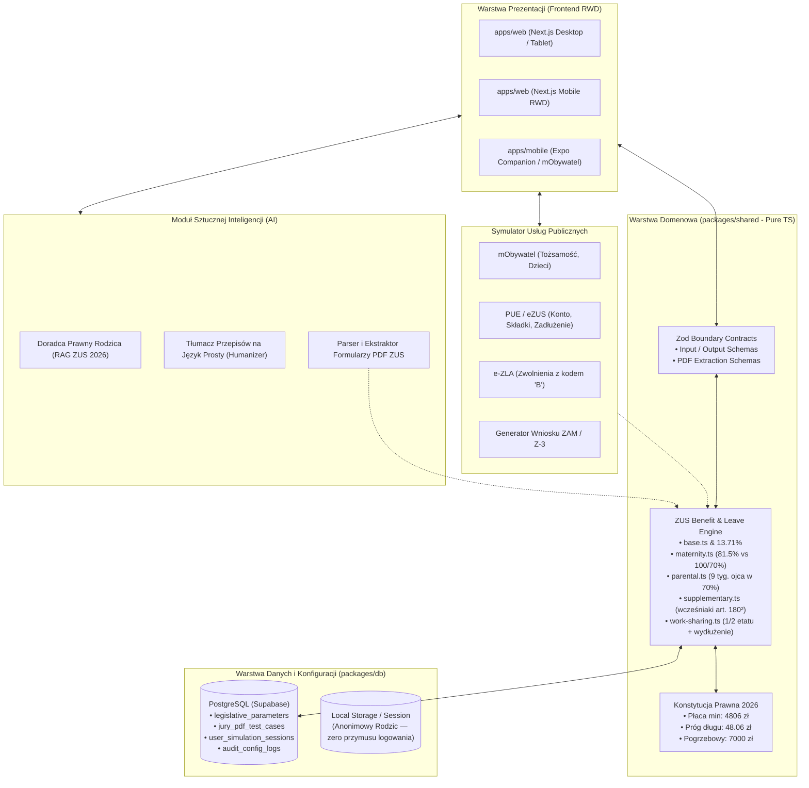
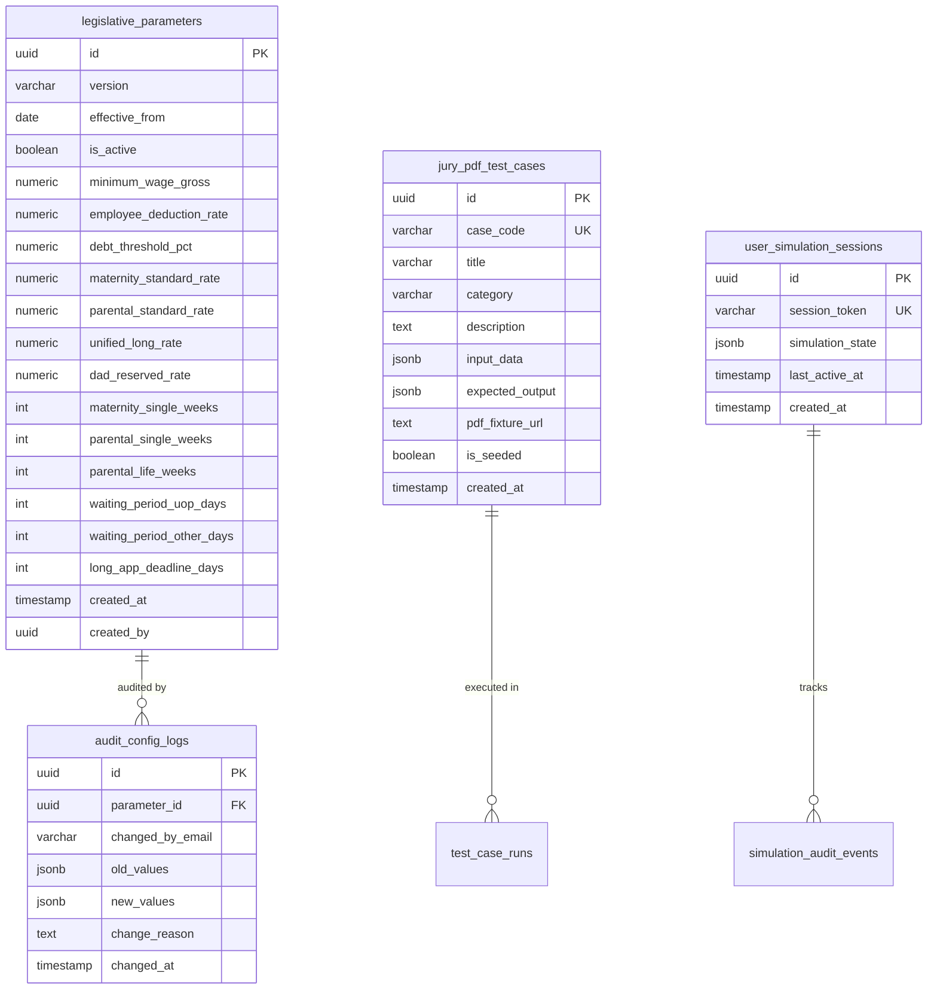

# ARCHITECTURE.md — Zasiłkowy Przewodnik Przyszłego Rodzica
**Projekt:** Zasiłkowy Przewodnik Przyszłego Rodzica  
**Wydarzenie:** HackNation 2026 | **Organizator:** Ministerstwo Cyfryzacji | **Partner:** Zakład Ubezpieczeń Społecznych (ZUS)  
**Status:** Wersja Kanoniczna v1.0 (Single Source of Truth)  
**Standardy:** Senior Architect Protocol, AGENTS.md, Clean Architecture, Domain-Driven Hexagon, Bulletproof React

---

## 1. WPROWADZENIE I DEKLARACJA MISJI SYSTEMU

### 1.1. Kontekst Wyzwania
W obecnym modelu ZUS dowiaduje się o narodzinach dziecka i zamiarze pobierania zasiłków dopiero po fakcie – gdy wpływa wniosek po porodzie. Obywatele zmagają się ze skomplikowanym gąszczem prawnym (dyrektywa Work-Life Balance, 9 nieprzenoszalnych tygodni dla ojca, uśredniona stawka 81,5% vs 100%/70%, terminy 21 dni, praca na 1/2 etatu z wydłużeniem rodzicielskiego, nowe przepisy dla wcześniaków art. 180² KP). Błędy we wnioskach i przekroczone terminy rodzą tysiące postępowań odmownych, odwołań sądowych i gigantyczne koszty operacyjne po stronie ZUS.

### 1.2. Misja i Rozwiązanie
**„Zasiłkowy Przewodnik Przyszłego Rodzica”** to zintegrowana platforma edukacyjno-obliczeniowa, która:
1. **Prowadzi rodzica „za rękę” od etapu planowania ciąży** przez poród aż po powrót do pracy (Interaktywna Mapa Drogowa).
2. **Eliminuje asymetrię informacji i ryzyko utraty świadczeń** (ostrzeżenia przed utratą prawa do 81,5%, zarzutem pozorności zatrudnienia, zadłużeniem w JDG przekraczającym 48,06 zł).
3. **Precyzyjnie kalkuluje świadczenia i optymalizuje budżet rodziny** przy użyciu niezależnego, certyfikowanego silnika matematycznego zgodnego ze stanem prawnym 2026.
4. **Symuluje realny ekosystem cyfrowy państwa** (mObywatel, PUE/eZUS, e-ZLA z kodem „B”, rejestr USC oraz generator wniosku ZAM łączącego dawne ZAM, ZUR i ZAO).
5. **Daje ZUS gotowy do wdrożenia moduł administracyjny**, pozwalający urzędnikom zmieniać wskaźniki i stawki legislacyjne w czasie rzeczywistym bez dotykania kodu.
6. **Zapewnia jurorom natychmiastowe środowisko weryfikacji (Jury Sandbox)** z predefiniowanymi kazusami i możliwością testowania własnych plików PDF.

---

## 2. STRUKTURA MONOREPO I GRANICE PAKIETÓW (TURBOREPO + PNPM)

Zgodnie z `AGENTS.md`, system zorganizowany jest jako monorepo oparte na Turborepo i pnpm workspaces:

```
HackNation/
├── apps/
│   ├── web/                         # Główna aplikacja webowa (Next.js 15+ App Router, RSC, Tailwind, RWD)
│   │   ├── src/
│   │   │   ├── app/                 # Routing Next.js (App Router)
│   │   │   │   ├── layout.tsx       # Root layout z motywem gov.pl/ZUS
│   │   │   │   ├── page.tsx         # Strona główna / Hub przewodnikowy
│   │   │   │   ├── przewodnik/      # Moduł 1: Interaktywna Mapa Drogowa
│   │   │   │   ├── kalkulator/      # Moduł 2: Zintegrowany Kalkulator Zasiłków i Urlopów
│   │   │   │   ├── e-uslugi/        # Moduł 3: Symulator mObywatel / PUE / e-ZLA / ZAM
│   │   │   │   ├── trudne-sytuacje/ # Moduł 4: Centrum Wsparcia i Empatii
│   │   │   │   ├── admin/           # Moduł 5: Panel Konfiguracji Legislacyjnej ZUS
│   │   │   │   ├── jury-sandbox/    # Moduł 6: Strefa Testowa dla Jurorów (PDF)
│   │   │   │   ├── asystent-ai/     # Moduł 7: Inteligentny Doradca Prawny AI
│   │   │   │   └── api/             # REST / Route Handlers (np. parse-pdf, ai-chat, config)
│   │   │   ├── features/            # Feature-driven encapsulation (Bulletproof React)
│   │   │   │   ├── roadmap/         # Komponenty i hooki mapy drogowej
│   │   │   │   ├── calculator/      # Widoki, formularze i wykresy kalkulatora
│   │   │   │   ├── gov-simulator/   # Interfejsy symulacji mObywatel/PUE/eZUS/ZAM
│   │   │   │   ├── crisis-center/   # Widoki wsparcia empatycznego
│   │   │   │   ├── admin-panel/     # Widoki edycji parametrów prawnych
│   │   │   │   ├── jury-sandbox/    # Upload PDF, selektor kazusów, diff wyników
│   │   │   │   └── ai-advisor/      # Chatbot, widget RAG, wyjaśniacz przepisów
│   │   │   ├── components/          # Reużywalne klocki UI (Design System ZUS / Radix)
│   │   │   └── lib/                 # Integracje klienckie i serwerowe
│   │   └── public/                  # Assety, ikony, przykładowe formularze PDF ZUS
│   │
│   └── mobile/                      # Aplikacja mobilna Expo (React Native / Expo Router)
│       └── src/                     # Widok portfela mObywatel i powiadomień terminarza
│
├── packages/
│   ├── shared/                      # PURE TYPESCRIPT (zero React, zero Node-only APIs)
│   │   ├── src/
│   │   │   ├── calculator/          # Czyste funkcje matematyczne silnika zasiłkowego
│   │   │   │   ├── base.ts          # Podstawa wymiaru, 13.71%, stawka dzienna 1/30
│   │   │   │   ├── maternity.ts     # Macierzyński (20-37 tyg., 100% / 81.5%, podział z ojcem)
│   │   │   │   ├── parental.ts      # Rodzicielski (41-67 tyg., 9 tyg. ojca w 70%, wyrównanie 18.5%)
│   │   │   │   ├── supplementary.ts # Wcześniaki (art. 180² KP, reguła ceil, limity 8/15 tyg., 100%)
│   │   │   │   ├── work-sharing.ts  # Łączenie z pracą na 1/2 etatu (art. 182¹ᶠ KP, wydłużenie, zarobek)
│   │   │   │   ├── paternity.ts     # Ojcowski (14 dni, 100%, 1 lub 2 części, limit 12 m-cy)
│   │   │   │   ├── sick-leave-b.ts  # Chorobowe w ciąży kod B (100%, 270 dni, podział 33/34 dni)
│   │   │   │   ├── care.ts          # Opiekuńczy (80%, limit 60/30/14 dni, brak domownika)
│   │   │   │   └── index.ts         # Fasada kalkulatora (Unified Benefit Engine)
│   │   │   ├── zod/                 # Schematy walidacji Zod dla wszystkich granic wejścia
│   │   │   │   ├── calculator.schema.ts
│   │   │   │   ├── parameters.schema.ts
│   │   │   │   ├── pdf-case.schema.ts
│   │   │   │   └── ai-query.schema.ts
│   │   │   ├── types/               # TypeScript interfaces & types
│   │   │   ├── constants/           # Parametry prawne ZUS 2026 (domyślne)
│   │   │   └── index.ts             # Główny eksport pakietu
│   │
│   └── db/                          # Baza danych Supabase
│       ├── supabase/
│       │   └── migrations/          # Wersjonowane migracje SQL z RLS
│       ├── src/
│       │   ├── client.ts            # Fabryka klienta Supabase
│       │   └── database.types.ts    # Wygenerowane typy bazy danych
│       └── seed/                    # Dane początkowe (kazusy testowe, parametry 2026)
│
└── ZUS/                             # Materiały źródłowe i dokumentacja wyzwania
```

---

## 3. GLOBALNY SCHEMAT ARCHITEKTURY I PRZEPŁYWU DANYCH



---

## 4. KONSTYTUCJA DANYCH: TYPY I KONTRAKTY API (CONTRACT-FIRST)

Wszystkie kontrakty danych są zdefiniowane w `packages/shared` i chronione przez schematy Zod. Poniższe definicje stanowią jedyne źródło prawdy (Single Source of Truth) dla całego systemu.

### 4.1. Parametry Legislacyjne (Konfiguracja ZUS)
```typescript
export interface LegislativeParameters {
  id: string;
  version: string; // np. "2026.1"
  effectiveFrom: string; // ISO Date
  isActive: boolean;
  
  // Wskaźniki płacowe i składkowe
  minimumWageGross: number; // 4 806.00 zł
  employeeContributionDeductionRate: number; // 0.1371 (13.71%)
  debtThresholdPct: number; // 0.01 (1% płacy minimalnej = 48.06 zł)
  jdgMaxContributionBase: number; // 23 550.00 zł
  funeralBenefitAmount: number; // 7 000.00 zł

  // Stawki procentowe zasiłków
  maternityStandardRate: number; // 1.00 (100%)
  parentalStandardRate: number; // 0.70 (70%)
  unifiedLongRate: number; // 0.815 (81.5%)
  dadReservedParentalRate: number; // 0.70 (70% - zawsze stałe!)
  supplementaryPretermRate: number; // 1.00 (100%)
  paternityRate: number; // 1.00 (100%)
  careAllowanceRate: number; // 0.80 (80%)
  pregnancySickRate: number; // 1.00 (100%)

  // Limity tygodniowe urlopów
  maternityWeeksSingle: number; // 20
  maternityWeeksTwins: number; // 31
  maternityWeeksTriplets: number; // 33
  maternityWeeksQuadruplets: number; // 35
  maternityWeeksQuintupletsPlus: number; // 37
  maternityMandatoryMotherWeeks: number; // 14

  parentalWeeksSingle: number; // 41
  parentalWeeksMulti: number; // 43
  parentalWeeksLifeSingle: number; // 65 (Ustawa "Za życiem")
  parentalWeeksLifeMulti: number; // 67
  parentalReservedDadWeeks: number; // 9

  supplementaryPretermMaxWeeksEarly: number; // 15 (<28 tyg. lub <=1000g)
  supplementaryPretermMaxWeeksStandard: number; // 8 (28-37 tyg. lub hosp. >37 tyg.)

  // Okresy wyczekiwania (dni)
  waitingPeriodEmploymentDays: number; // 30
  waitingPeriodOtherDays: number; // 90
  
  // Terminy graniczne
  longApplicationDeadlineDays: number; // 21
  paternityDeadlineMonths: number; // 12
  debtRepaymentGracePeriodMonths: number; // 6
}
```

### 4.2. Wejście Kalkulatora (Unified Calculation Input)
```typescript
export interface BenefitCalculationInput {
  parentRole: 'mother' | 'father';
  contractType: 'employment' | 'mandate' | 'b2b';
  monthlyBaseGross: number; // Miesięczna podstawa / wynagrodzenie brutto
  
  // Dane o porodzie i dzieciach
  birthDate?: string; // ISO Date
  expectedBirthDate?: string; // ISO Date (dla opcji 6 tyg. przed)
  childrenCount: 1 | 2 | 3 | 4 | 5;
  hasLifeCertificate: boolean; // Zaświadczenie "Za życiem" (art. 4 ust. 3)
  isAdoptionOrFoster: boolean;
  childAgeAtAdoptionMonths?: number;

  // Ścieżka formalna wniosku
  submittedWithin21Days: boolean; // Czy ZAM złożony w terminie 21 dni
  startMaternityWeeksBeforeBirth: number; // 0 do 6 tygodni

  // Podział urlopu macierzyńskiego
  motherTakesFullMaternity: boolean; // true = 20 tyg. mama; false = 14 tyg. mama + 6 tyg. tata

  // Wcześniactwo i hospitalizacja (art. 180² KP)
  isPrematureOrHospitalized: boolean;
  birthWeek?: number; // Tydzień ciąży (np. 26)
  birthWeightGrams?: number; // Waga urodzeniowa w gramach (np. 950)
  hospitalizationDaysTotal?: number; // Suma dni hospitalizacji w oknie referencyjnym
  hospitalizationConsecutiveDaysAfterDay4?: number; // Dla dzieci urodzonych po 37 tyg.

  // Podział urlopu rodzicielskiego i ojcowskiego
  dadTakesReserved9Weeks: boolean;
  dadTakesPaternityLeave: boolean; // 14 dni urlopu ojcowskiego
  dadMonthlyBaseGross?: number; // Podstawa ojca (jeśli podaje)

  // Łączenie urlopu rodzicielskiego z pracą (art. 182¹ᶠ KP)
  workDuringParental: boolean;
  workFteRatio?: number; // np. 0.5 (1/2 etatu), 0.25 (1/4 etatu)
  workWeeksCount?: number; // Liczba tygodni łączenia
  
  // Historia ubezpieczenia i zadłużenie (JDG)
  insuranceDurationMonths: number;
  jdgCurrentDebtAmount?: number; // Kwota zaległości składkowych
}
```

### 4.3. Wyjście Kalkulatora (Unified Calculation Output)
```typescript
export interface BenefitCalculationOutput {
  // Podstawy finansowe
  netMonthlyBase: number; // Podstawa po odliczeniu 13.71%
  dailyBaseRate: number; // netMonthlyBase / 30

  // Urlop Macierzyński
  maternity: {
    totalWeeks: number;
    motherWeeks: number;
    fatherWeeks: number;
    weeklyBenefitMother: number;
    weeklyBenefitFather: number;
    monthlyEquivalentMother: number;
    monthlyEquivalentFather: number;
    totalAmountPaid: number;
    ratePct: number; // 81.5% lub 100%
  };

  // Uzupełniający Urlop Macierzyński (Wcześniaki)
  supplementaryPreterm: {
    isEligible: boolean;
    weeksGranted: number; // Zaokrąglone ceil(dni/7) z limitem 8 lub 15
    ratePct: number; // 100%
    weeklyBenefit: number;
    totalAmountPaid: number;
    legalBasis: string; // "Art. 180² § 1 pkt X KP"
  };

  // Urlop Rodzicielski
  parental: {
    totalWeeksPool: number;
    motherAvailableWeeks: number;
    dadReservedWeeks: number; // 9 tygodni
    rateMotherPct: number; // 81.5% lub 70%
    rateDadReservedPct: number; // Zawsze 70%
    weeklyBenefitMother: number;
    weeklyBenefitDad: number;
    totalAmountMother: number;
    totalAmountDad: number;
    equalizationRefundAmountIfCancelled: number; // Wyrównanie 18.5% jeśli nie skorzysta
  };

  // Łączenie z pracą na część etatu
  workSharing: {
    isApplied: boolean;
    fteRatio: number;
    combinedWeeks: number;
    extensionWeeks: number; // weeks * fte
    totalExtendedDurationWeeks: number;
    reducedWeeklyBenefit: number; // base * (1 - fte)
    salaryFromEmployerWeekly: number; // pensja z pracy na część etatu
    totalWeeklyIncomeCombined: number; // zasiłek + pensja
    isTotalBenefitPoolPreserved: boolean; // true (łączna suma zasiłku 100% zachowana)
  };

  // Urlop Ojcowski
  paternity: {
    isEligible: boolean;
    daysCount: number; // 14 dni
    ratePct: number; // 100%
    totalAmountPaid: number;
    deadlineDate: string; // Data 1. urodzin dziecka
  };

  // Podsumowanie Globalne Budżetu Rodziny
  summary: {
    grandTotalBenefitAmount: number; // Suma wszystkich wypłaconych zasiłków
    grandTotalFamilyIncome: number; // Zasiłki + pensja z pracy łączonej
    totalWeeksOfCare: number; // Łączna liczba tygodni opieki nad dzieckiem
    variantComparison: {
      optionA_Unified815: {
        totalAmount: number;
        pros: string[];
        cons: string[];
      };
      optionB_Standard100_70: {
        totalAmount: number;
        pros: string[];
        cons: string[];
      };
      recommendedOption: 'optionA' | 'optionB';
      differenceAmount: number;
    };
  };

  // Ostrzeżenia i Ryzyka Prawne (Risk Engine)
  risksAndWarnings: Array<{
    code: 'DEBT_BLOCK' | 'MISSED_21_DAYS' | 'WAITING_PERIOD' | 'DAD_9_WEEKS_EXPIRATION' | 'SHAM_EMPLOYMENT_RISK';
    severity: 'error' | 'warning' | 'info';
    title: string;
    description: string;
    actionRequired: string;
    legalReference: string;
  }>;
}
```

---

## 5. ARCHITEKTURA BAZY DANYCH (SUPABASE POSTGRESQL & RLS)

Projekt wykorzystuje PostgreSQL w architekturze Supabase. Zgodnie z `AGENTS.md` oraz żelaznym protokołem architektonicznym:
- Każda tabela posiada włączone RLS (`ROW LEVEL SECURITY`).
- Wszystkie klucze obce posiadają indeksy (`B-Tree`).
- Wszystkie zapytania RLS używają optymalnego `(SELECT auth.uid())`.
- Dostęp publiczny jest zabezpieczony (użytkownik anonimowy może symulować bez zakładania konta; dane wrażliwe nie wyciekają).

### 5.1. Schemat Tabel Relacyjnych



### 5.2. Skrypt Migracji SQL (`supabase/migrations/20261121000001_zus_core_schema.sql`)
```sql
-- Włączenie rozszerzenia UUID
CREATE EXTENSION IF NOT EXISTS "uuid-ossp";

-- 1. Tabela Parametrów Legislacyjnych ZUS
CREATE TABLE IF NOT EXISTS public.legislative_parameters (
    id UUID PRIMARY KEY DEFAULT uuid_generate_v4(),
    version VARCHAR(32) NOT NULL UNIQUE,
    effective_from DATE NOT NULL,
    is_active BOOLEAN NOT NULL DEFAULT false,
    
    minimum_wage_gross NUMERIC(10, 2) NOT NULL DEFAULT 4806.00,
    employee_deduction_rate NUMERIC(6, 4) NOT NULL DEFAULT 0.1371,
    debt_threshold_pct NUMERIC(6, 4) NOT NULL DEFAULT 0.0100,
    jdg_max_contribution_base NUMERIC(10, 2) NOT NULL DEFAULT 23550.00,
    funeral_benefit_amount NUMERIC(10, 2) NOT NULL DEFAULT 7000.00,

    maternity_standard_rate NUMERIC(6, 4) NOT NULL DEFAULT 1.0000,
    parental_standard_rate NUMERIC(6, 4) NOT NULL DEFAULT 0.7000,
    unified_long_rate NUMERIC(6, 4) NOT NULL DEFAULT 0.8150,
    dad_reserved_rate NUMERIC(6, 4) NOT NULL DEFAULT 0.7000,
    supplementary_preterm_rate NUMERIC(6, 4) NOT NULL DEFAULT 1.0000,
    paternity_rate NUMERIC(6, 4) NOT NULL DEFAULT 1.0000,
    care_allowance_rate NUMERIC(6, 4) NOT NULL DEFAULT 0.8000,
    pregnancy_sick_rate NUMERIC(6, 4) NOT NULL DEFAULT 1.0000,

    maternity_single_weeks INT NOT NULL DEFAULT 20,
    maternity_twins_weeks INT NOT NULL DEFAULT 31,
    maternity_triplets_weeks INT NOT NULL DEFAULT 33,
    maternity_quadruplets_weeks INT NOT NULL DEFAULT 35,
    maternity_quintuplets_weeks INT NOT NULL DEFAULT 37,
    maternity_mandatory_mother_weeks INT NOT NULL DEFAULT 14,

    parental_single_weeks INT NOT NULL DEFAULT 41,
    parental_multi_weeks INT NOT NULL DEFAULT 43,
    parental_life_single_weeks INT NOT NULL DEFAULT 65,
    parental_life_multi_weeks INT NOT NULL DEFAULT 67,
    parental_reserved_dad_weeks INT NOT NULL DEFAULT 9,

    preterm_max_weeks_early INT NOT NULL DEFAULT 15,
    preterm_max_weeks_standard INT NOT NULL DEFAULT 8,

    waiting_period_uop_days INT NOT NULL DEFAULT 30,
    waiting_period_other_days INT NOT NULL DEFAULT 90,
    long_app_deadline_days INT NOT NULL DEFAULT 21,
    debt_grace_period_months INT NOT NULL DEFAULT 6,

    created_at TIMESTAMPTZ NOT NULL DEFAULT now(),
    updated_at TIMESTAMPTZ NOT NULL DEFAULT now()
);

-- Indeks na aktywną konfigurację
CREATE INDEX IF NOT EXISTS idx_legislative_params_active ON public.legislative_parameters(is_active) WHERE is_active = true;

-- 2. Tabela Logów Audytu Zmian Legislacyjnych (Panel Administratora)
CREATE TABLE IF NOT EXISTS public.audit_config_logs (
    id UUID PRIMARY KEY DEFAULT uuid_generate_v4(),
    parameter_id UUID NOT NULL REFERENCES public.legislative_parameters(id) ON DELETE CASCADE,
    changed_by_email VARCHAR(255) NOT NULL,
    old_values JSONB NOT NULL,
    new_values JSONB NOT NULL,
    change_reason TEXT NOT NULL,
    changed_at TIMESTAMPTZ NOT NULL DEFAULT now()
);

CREATE INDEX IF NOT EXISTS idx_audit_config_param_id ON public.audit_config_logs(parameter_id);

-- 3. Tabela Predefiniowanych Kazusów dla Jurorów (PDF Jury Sandbox)
CREATE TABLE IF NOT EXISTS public.jury_pdf_test_cases (
    id UUID PRIMARY KEY DEFAULT uuid_generate_v4(),
    case_code VARCHAR(32) NOT NULL UNIQUE,
    title VARCHAR(255) NOT NULL,
    category VARCHAR(64) NOT NULL,
    description TEXT NOT NULL,
    input_data JSONB NOT NULL,
    expected_output JSONB NOT NULL,
    pdf_fixture_url TEXT,
    is_seeded BOOLEAN NOT NULL DEFAULT true,
    created_at TIMESTAMPTZ NOT NULL DEFAULT now()
);

CREATE INDEX IF NOT EXISTS idx_jury_test_cases_code ON public.jury_pdf_test_cases(case_code);
CREATE INDEX IF NOT EXISTS idx_jury_test_cases_category ON public.jury_pdf_test_cases(category);

-- 4. Tabela Anonimowych Sesji Symulacji (Opcjonalny zapis postępu rodzica)
CREATE TABLE IF NOT EXISTS public.user_simulation_sessions (
    id UUID PRIMARY KEY DEFAULT uuid_generate_v4(),
    session_token VARCHAR(64) NOT NULL UNIQUE,
    simulation_state JSONB NOT NULL,
    last_active_at TIMESTAMPTZ NOT NULL DEFAULT now(),
    created_at TIMESTAMPTZ NOT NULL DEFAULT now()
);

CREATE INDEX IF NOT EXISTS idx_sim_sessions_token ON public.user_simulation_sessions(session_token);

-- Włączenie RLS dla wszystkich tabel
ALTER TABLE public.legislative_parameters ENABLE ROW LEVEL SECURITY;
ALTER TABLE public.audit_config_logs ENABLE ROW LEVEL SECURITY;
ALTER TABLE public.jury_pdf_test_cases ENABLE ROW LEVEL SECURITY;
ALTER TABLE public.user_simulation_sessions ENABLE ROW LEVEL SECURITY;

-- Polityki RLS:
-- Parametry prawne: Każdy może czytać aktywny rekord (anon & auth)
CREATE POLICY "Public read active parameters" ON public.legislative_parameters
    FOR SELECT USING (true);

-- Jury Test Cases: Każdy może czytać kazusy testowe (anon & auth)
CREATE POLICY "Public read jury test cases" ON public.jury_pdf_test_cases
    FOR SELECT USING (true);

-- Sesje symulacji: Każdy może tworzyć i czytać własną sesję po tokenie
CREATE POLICY "Public create and read own simulation" ON public.user_simulation_sessions
    FOR ALL USING (true) WITH CHECK (true);

-- Audyt i edycja parametrów: Tylko rola authenticated z uprawnieniami admina
CREATE POLICY "Admin manage legislative parameters" ON public.legislative_parameters
    FOR ALL TO authenticated USING (auth.jwt() ->> 'role' = 'zus_admin');

CREATE POLICY "Admin view audit logs" ON public.audit_config_logs
    FOR SELECT TO authenticated USING (auth.jwt() ->> 'role' = 'zus_admin');
```

---

## 6. SZCZEGÓŁOWA SPECYFIKACJA SIEDMIU MODUŁÓW SYSTEMU

### 6.1. Moduł 1: Interaktywna Mapa Drogowa (Roadmap & Journey Timeline)
* **Cel:** Przeprowadzić rodzica krok po kroku przez gąszcz formalności od decyzji o powiększeniu rodziny aż po powrót do pracy po urlopach.
* **4 Główne Kamienie Milowe:**
  1. *Etap 1: Planowanie & Wczesna Ciąża* (audyt tytułu ubezpieczenia, weryfikacja okresu wyczekiwania 30/90 dni, kontrola zadłużenia w FUS).
  2. *Etap 2: Ciąża & Zwolnienie e-ZLA z kodem „B”* (prawo do 100% chorobowego do 270 dni, podział: pierwsze 33 dni pracodawca, od 34. dnia ZUS; ochrona trwałości umowy z mocy art. 177 § 3 KP).
  3. *Etap 3: Poród & Okno Decyzyjne 21 Dni* (rejestracja w USC, zgłoszenie do NFZ, wybór wariantu 81,5% vs 100%/70%, dynamiczny licznik odliczający 21 dni).
  4. *Etap 4: Opieka w 1. Roku & Powrót do Pracy* (macierzyński, urlop uzupełniający dla wcześniaków, rodzicielski z żelazną rezerwacją 9 tygodni dla taty, łączenie z pracą na 1/2 etatu z wydłużeniem, ojcowski 14 dni, opiekuńczy 60 dni).
* **Interaktywność:**
  - Dynamiczny pasek postępu (Progress Bar) z zaznaczeniem aktualnego tygodnia ciąży / wieku dziecka.
  - Generowanie spersonalizowanej listy zadań („To-Do Checklist”) z możliwością eksportu do kalendarza (iCal / Google Calendar).
  - Wskaźniki ryzyka i prawne callouty w odpowiednich punktach osi czasu.

### 6.2. Moduł 2: Zintegrowany Kalkulator Zasiłków i Urlopów (Core Calculator)
* **Silnik Matematyczny (`packages/shared/src/calculator`):**
  - Czysto funkcyjny, bezstanowy, w 100% testowalny jednostkowo.
  - Uwzględnia potrącenie składek pracowniczych ($13,71\% \rightarrow 0,8629$).
  - Stawka dzienna zawsze dzielona przez 30 (zgodnie z art. 11 ust. 5 i art. 31 ust. 5 ustawy).
  - Oblicza pełne scenariusze dla UoP, Zlecenia i JDG.
* **Scenariusze Specjalne wbudowane w silnik:**
  - *Dyrektywa Work-Life Balance:* 9 nieprzenoszalnych tygodni dla drugiego rodzica (zawsze w stawce 70%).
  - *Nowe przepisy dla wcześniaków (Art. 180² KP):* Uzupełniający urlop macierzyński płatny w 100%, formuła $\lceil \text{dni}/7 \rceil$, limity 8 lub 15 tygodni.
  - *Ustawa „Za życiem”:* Wydłużenie rodzicielskiego do 65 tygodni (jedno dziecko) lub 67 tygodni (wieloraczki).
  - *Praca na część etatu (Art. 182¹ᶠ KP):* Wydłużenie urlopu rodzicielskiego (max podwojenie do 82/86 lub 130/134 tyg.), proporcjonalne obniżenie zasiłku z zachowaniem 100% łącznej puli świadczenia.
  - *Mechanizm wyrównania 18,5%:* Automatyczna kalkulacja dopłaty, jeśli matka wzięła 81,5%, a nie wykorzystała rodzicielskiego.
* **Prezentacja UX:**
  - Porównywarka „Wariant 81,5% vs Wariant 100/70%” z czytelnym podsumowaniem zysków/strat.
  - Wykresy słupkowe i kaskadowe (Cash Flow) pokazujące przepływ środków w każdym miesiącu życia dziecka.
  - Rozbicie dochodu: wkład Mamy vs wkład Taty vs pensja z pracy łączonej.

### 6.3. Moduł 3: Symulacje Integracji Rządowych (Gov Services Simulator)
* **mObywatel:**
  - Wiernie odwzorowany interfejs aplikacji mObywatel (karta mObywatel, mLegitymacja, cyfrowe odpisy aktów urodzenia dzieci).
  - Możliwość „Zaloguj przez Węzeł Krajowy / Profil Zaufany” – automatyczne wypełnienie profilu rodzica.
* **PUE / eZUS:**
  - Symulacja portalu ubezpieczonego: podgląd zgłoszeń ZUS ZUA/ZZA, kwoty odprowadzonych składek.
  - Wskaźnik zadłużenia przedsiębiorcy (kontrola progu $48,06\text{ zł}$ z symulacją spłaty w terminie 6 miesięcy).
* **e-ZLA (Elektroniczne Zwolnienia Lekarskie):**
  - Podgląd wystawionego przez lekarza zwolnienia z wyraźnie zaznaczonym kodem **„B”** (ciąża).
  - Wskazanie płatnika: odliczanie 33 dni pracodawcy i płynne przejście na wypłatę przez ZUS od 34. dnia.
* **Generator Wniosku ZAM i Z-3:**
  - Pełne odwzorowanie nowego skonsolidowanego formularza ZAM (obowiązującego od 24.10.2026 r., który zastąpił ZAM, ZUR i ZAO!).
  - Zaświadczenie płatnika Z-3 / Z-3a.
  - Natychmiastowy podgląd w formacie urzędowym i pobranie pliku PDF.

### 6.4. Moduł 4: Panel Konfiguracji Legislacyjnej ZUS (Admin Panel)
* **Kluczowy atut punktacyjny (15% wdrożenie):**
  - Panel dla uprawnionego pracownika Departamentu Zasiłków ZUS.
  - Możliwość edycji dowolnej stawki (np. zmiana uśrednionej stawki z 81,5% na 85%, podwyższenie płacy minimalnej, modyfikacja progu długu).
  - Przełącznik „Wersja projektu ustawy” – natychmiastowe przeliczenie symulacji w całej aplikacji bez restartu serwera i bez zmian w kodzie.
  - Pełny rejestr audytu (Audit Trail) w tabeli `audit_config_logs` z historią zmian i uzasadnieniem.

### 6.5. Moduł 5: Moduł Testowy dla Jurorów (PDF Jury Sandbox)
* **Odpowiedź na obowiązkowy wymóg regulaminowy wyzwania:**
  - Dedykowana strefa w nawigacji: `/jury-sandbox`.
  - **Szybki wybór kazusów (6 oficjalnych scenariuszy testowych ZUS):**
    1. *Kazus 1:* Pracownica UoP, wniosek w 21 dni, wariant 81,5%, 9 tygodni taty.
    2. *Kazus 2:* Przedsiębiorczyni z zaległością składkową 120 zł (blokada wypłaty z art. 2a i procedura 6 miesięcy).
    3. *Kazus 3:* Skrajny wcześniak (26. tydzień ciąży, 850 g, 70 dni hospitalizacji) – przyznanie 15 tygodni uzupełniającego 100%.
    4. *Kazus 4:* Złożenie wniosku po 25 dniach – automatyczny podział na 100% i 70% oraz kalkulacja straty.
    5. *Kazus 5:* Praca na 1/2 etatu przez 20 tygodni rodzicielskiego – wydłużenie o 10 tygodni, zasiłek 40,75% + 50% pensji.
    6. *Kazus 6:* Dziecko z zaświadczeniem „Za życiem” – wydłużenie rodzicielskiego do 65 tygodni i ścieżka hospicjum perinatalnego.
  - **Strefa Uploadu Plików PDF:**
    - Juror przeciąga plik formularza Z-3, ZAM lub orzeczenia medycznego.
    - Wbudowany parser PDF wyciąga parametry (pensja, forma umowy, stan hospitalizacji, daty wniosków).
    - Natychmiastowe uruchomienie silnika kalkulatora i wyświetlenie werdyktu decyzyjnego ZUS.

### 6.6. Moduł 6: Inteligentny Doradca Prawny AI (AI Assistant)
* **Funkcjonalność AI:**
  - Asystent konwersacyjny wytrenowany na przepisach ustawy zasiłkowej, Kodeksu pracy i Poradnika ZUS 2026.
  - *Funkcja Humanizera:* Przycisk „Wyjaśnij po ludzku” przy każdym skomplikowanym artykule prawnym.
  - Prewencja błędów: asystent weryfikuje wpisane przez rodzica dane i ostrzega o potencjalnych brakach formalnych przed złożeniem wniosku.
  - Oznaczenie modułu etykietą „Moduł AI” zgodnie z wymogami konkursu.

### 6.7. Moduł 7: Centrum Wsparcia i Empatii w Sytuacjach Trudnych
* **Delikatne i stonowane podejście do traumatycznych wydarzeń:**
  - *Urodzenie martwego dziecka / Poronienie:* Pełne wyjaśnienie prawa do 8 tygodni (56 dni) urlopu macierzyńskiego w stawce 100%, procedura karty martwego urodzenia w szpitalu, zasiłek pogrzebowy $7\,000\text{ zł}$.
  - *Zgon dziecka po 8. tygodniu życia:* Prawo do 7 dni zasiłku macierzyńskiego od dnia zgonu.
  - *Ustawa „Za życiem”:* Kompleksowy przewodnik po uprawnieniach rodziców dzieci z wadami letalnymi.
  - *Baza Pomocy:* Zweryfikowane kontakty do organizacji pozarządowych (Fundacja Rodzić po Ludzku, Fundacja Gajusz / Hospicja Perinatalne, Koalicja dla Wcześniaka, telefon wsparcia po stracie).

---

## 7. ARCHITEKTURA INTERFEJSU UŻYTKOWNIKA I RESPONSYWNOŚCI (RWD)

Zgodnie z protokołem Senior Architect:
1. **System Siatki (Responsive Grid / Flexbox):**
   - Żadnych sztywnych marginesów (typu `margin-top: 47px`).
   - Układ płynny: Tailwind CSS (`grid grid-cols-1 md:grid-cols-2 lg:grid-cols-12 gap-6`).
   - Dostosowanie do ekranów mobilnych (320px), tabletów (768px), desktopów (1024px–1920px) i 4K.
2. **Obsługa Wszystkich Stanów UI:**
   - **Loading:** Szkielety komponentów (Skeleton loaders), pulsujące placeholdery.
   - **Error:** Komponenty Alert z kodem błędu, wyjaśnieniem po ludzku i przyciskiem ponowienia (Retry).
   - **Empty:** Estetyczne ilustracje pustego stanu z bezpośrednim wezwaniem do akcji (CTA).
   - **Success:** Potwierdzenia animowane, podsumowania kalkulacji z możliwością pobrania PDF.
3. **Komponenty Dostępne (a11y):**
   - Semantyczny HTML5 (`<main>`, `<header>`, `<nav>`, `<article>`, `<section>`).
   - Kontrast kolorystyczny WCAG 2.1 AA (czerń, biel, urzędowy błękit ZUS `#005A9C`, zieleń `#107C41`, stonowany burgund dla alertów).
   - Sentence case we wszystkich etykietach i przyciskach (zakaz ALL CAPS).

---

## 8. PROCES IMPLEMENTACJI I PROTOKÓŁ WERYFIKACJI E2E

### 8.1. Kroki Wdrożeniowe (Implementation Phases)
1. **Faza 1 (Fundamenty & Konstytucja Danych):** Inicjalizacja monorepo Turborepo, wdrożenie `packages/shared` (typy, schematy Zod, pure calculation engine), testy jednostkowe matematyki.
2. **Faza 2 (Warstwa Danych & Migracje):** Utworzenie tabel w `packages/db`, polityki RLS, seedowanie kazusów testowych i parametrów 2026.
3. **Faza 3 (Równoległa Konstrukcja Modułów UI w `apps/web`):**
   - Moduł Kalkulatora & Porównywarki Wariantów.
   - Moduł Interaktywnej Mapy Drogowej (Roadmap).
   - Moduł Symulacji e-Usług (mObywatel, PUE/eZUS, ZAM).
   - Moduł Jury Sandbox (kazusy + upload PDF).
   - Moduł Panelu Administratora ZUS.
   - Moduł Sytuacji Trudnych i Asystenta AI.
4. **Faza 4 (Integracja i Testy End-to-End):** Weryfikacja spójności typów, testy E2E z użyciem Chrome DevTools, testy RWD na różnych rozdzielczościach.
5. **Faza 5 (Materiały Końcowe):** Prezentacja (do 10 slajdów), wideo demo (do 3 minut), dokumentacja uruchomieniowa.

### 8.2. Kryteria Odbioru (Definition of Done — AGENTS.md):
- `pnpm typecheck` przechodzi bez żadnych błędów w całym monorepo.
- `pnpm lint` czysty (zero naruszeń reguł).
- `pnpm test` – testy jednostkowe silnika kalkulatora pokrywają 100% kluczowych ścieżek matematycznych.
- UI przetestowany wizualnie w przeglądarce – brak jakichkolwiek błędów w konsoli deweloperskiej.
- Brak pustych przycisków i atrap – każdy komponent realizuje rzeczywistą akcję.
