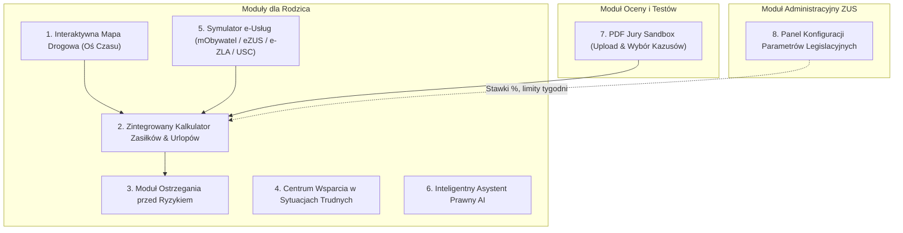
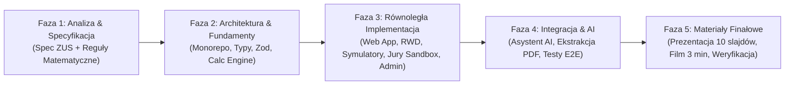

# SPECYFIKACJA WYZWANIA ZUS: ZASIŁKOWY PRZEWODNIK PRZYSZŁEGO RODZICA
**Wydarzenie:** HackNation 2026  
**Organizator:** Ministerstwo Cyfryzacji | **Operator:** PROIDEA sp. z o.o.  
**Partner i Przyrzekający Nagrodę:** Zakład Ubezpieczeń Społecznych (ZUS)  
**Nagroda Główna:** 30 000 zł brutto (przelew w 7 dni od umowy i przekazania kodu)  
**Dokumenty Źródłowe:** 
- `ZUS - Regulamin zadania konkursowego.pdf`
- `ZUS - Pełna treść zadania konkursowego.pdf`
- `AGENTS.md` (HackNation Monorepo Architecture)

---

## 1. WPROWADZENIE I DIAGNOZA PROBLEMU BIZNESOWEGO

### 1.1. Kontekst Zakładu Ubezpieczeń Społecznych (ZUS)
ZUS jest filarem polskiego systemu zabezpieczenia społecznego. Gromadzi składki na FUS i wypłaca rocznie setki tysięcy świadczeń z tytułu choroby i macierzyństwa.
W systemie występują 3 kluczowe podmioty:
1. **Płatnik składek** – pracodawca / zleceniodawca. Płatnicy zgłaszający powyżej 20 ubezpieczonych sami ustalają prawo i wypłacają zasiłki; dla płatników zgłaszających do 20 ubezpieczonych świadczenia ustala i wypłaca ZUS.
2. **Ubezpieczony** – osoba objęta ubezpieczeniem chorobowym (obowiązkowo: umowa o pracę; dobrowolnie: umowa zlecenie, pozarolnicza działalność gospodarcza).
3. **Świadczeniobiorca** – osoba pobierająca zasiłek.

### 1.2. Główny Ból ZUS (Problem Systemowy)
- **Asymetria informacji i brak wczesnej wiedzy:** W stanie obecnym ZUS dowiaduje się o narodzinach dziecka i związanych z tym świadczeniach **dopiero po porodzie**.
- **Koszty operacyjne i spory prawne:** Tysiące wniosków składanych jest błędnie, po terminie, bez wymaganych załączników (np. brak Z-3/Z-3a, brak aktu urodzenia, brak zaświadczeń szpitalnych/„Za życiem”). Prowadzi to do przewlekłej korespondencji wyjaśniającej, postępowań odmownych, zaskoczenia obywateli, a w konsekwencji kosztownych sporów i procesów sądowych.
- **Wizerunek instytucji:** Frustracja rodziców spowodowana zawiłością przepisów i obniżeniem/utratą zasiłków rzutuje negatywnie na odbiór ZUS.

### 1.3. Główny Ból Rodziców (Beneficjentów)
- **Niezrozumiały gąszcz prawny:** Trudność w ustaleniu wymiaru i wysokości świadczeń (zbieg reguł: 100%, 70%, 81,5%, 9 nieprzenoszalnych tygodni dla ojca).
- **Krytyczne terminy i utrata pieniędzy:** Przekroczenie terminu 21 dni od porodu na złożenie „długiego wniosku” bezpowrotnie pozbawia matkę równej stawki 81,5% za cały okres.
- **Strach przed łączeniem pracy z rodzicielstwem:** Rodzice nie wiedzą, że mogą pracować do 1/2 etatu na urlopie rodzicielskim z jednoczesnym proporcjonalnym wydłużeniem urlopu i pobieraniem zasiłku.
- **Sytuacje kryzysowe i szczególne:** Brak empatii i czytelnej ścieżki w traumatycznych momentach (poronienie, zgon dziecka, wcześniactwo i hospitalizacja, ciężkie wady w ramach ustawy „Za życiem”).
- **Wielomandatowość form zatrudnienia:** Zbieg umowy o pracę, zlecenia, działalności gospodarczej, problem okresów wyczekiwania (30 dni vs 90 dni) i zadłużenia składkowego u przedsiębiorców.

---

## 2. KRYTERIA OCENY JURY I WAGI PUNKTACJI

Zgodnie z Rozdziałem 8 zadania konkursowego, prace oceniane są według 5 precyzyjnych kryteriów (suma: 100%):

| Kryterium | Waga | Co decyduje o maksymalnej nocie (100% w kryterium) |
|---|:---:|---|
| **Związek z wyzwaniem** | **25%** | Precyzyjne zaadresowanie specyfiki ZUS: rozwiązanie problemu braku wiedzy przed porodem, wdrożenie wszystkich typów zasiłków (ciążowy, macierzyński, rodzicielski, ojcowski, uzupełniający dla wcześniaków, adopcja, „Za życiem”), perfekcyjna zgodność z polskim prawem zasiłkowym. |
| **Kompletność projektu i User Experience (UX)** | **25%** | Dopracowany, intuicyjny, prosty w odbiorze interfejs (Humanizer / plain language). Pełna responsywność (RWD), obsługa wszystkich stanów UI (loading, error, empty, success), zero „pustych przycisków”, prowadzenie rodzica „za rękę” w formie interaktywnej osi czasu / mapy drogowej. |
| **Pomysł** | **20%** | Nowatorskie podejście do edukacji obywatela: symulator decyzji finansowych, planer dzielenia opieki między rodzicami z optymalizatorem budżetu domowego, personalizowany asystent proaktywny. |
| **Oryginalność** | **15%** | Unikalne funkcje wykraczające poza standardowe kalkulatory: symulacje integracji rządowych (mObywatel, eZUS, e-ZLA z kodem „B”, weryfikacja długu składkowego), moduł predykcji ryzyka i kontroli ZUS, detektor prawa do odpisów z Rejestru Stanu Cywilnego. |
| **Potencjał wdrożeniowy** | **15%** | Projekt gotowy do wdrożenia jako inspiracja dla ZUS/gov.pl. Architektura REST API, modularność, Panel Administracyjny umożliwiający urzędnikom dynamiczną zmianę parametrów i stawek legislacyjnych bez dotykania kodu źródłowego. |

---

## 3. WYMAGANIA FORMALNE I PAKIET ZGŁOSZENIOWY

Projekt musi zostać przekazany do oceny z kompletem następujących elementów:

1. **Szczegółowy opis i tytuł projektu** – jasna nazwa, misja, architektura, opis wartości dla ZUS i obywatela.
2. **Prezentacja projektu (Pitch Deck):**
   - **Maksymalnie 10 slajdów** (bezwzględny limit formalny).
   - Slajdy muszą syntetycznie pokrywać: problem, rozwiązanie, architekturę, demonstrację UX/kalkulatora, sekcję AI, wdrożenie i korzyści dla ZUS.
3. **Film demonstracyjny (Video Demo):**
   - **Maksymalnie 3 minuty** trwania.
   - Umieszczony w otwartym, dostępnym repozytorium (link).
   - Prezentujący działający projekt, scenariusze użycia i interfejs.
   - Może być również zintegrowany bezpośrednio wewnątrz samej aplikacji webowej.
4. **Publiczne repozytorium kodu źródłowego:**
   - Przejrzysta struktura monorepo Turborepo + pnpm.
   - Historia commitów w języku angielskim (imperative mood).
   - Instrukcja uruchomienia lokalnego (`README.md`).
5. **Działająca demonstracja internetowa (Public Live Demo):**
   - Nowoczesna aplikacja webowa w architekturze **Responsive Web Design (RWD)** – automatyczne dostosowanie do desktopów, tabletów i smartfonów (od 320px do 4K).
   - **Moduł Testowy dla Jurorów (PDF Jury Sandbox):**
     * Możliwość wyboru predefiniowanych kazusów ZUS (z załączonych dokumentów w PDF).
     * Możliwość własnego **uploadu plików PDF** (formularze ZAM, Z-3, Z-3a, zaświadczenia lekarskie e-ZLA).
     * Natychmiastowe przeliczenie uprawnień, weryfikacja ubezpieczenia i kalkulacja kwotowa na oczach jurora.
6. **Wskazanie funkcjonalności opartych o Sztuczną Inteligencję (AI):**
   - Wyraźne oznaczenie modułów AI w UI i dokumentacji.
   - Deklaracja użycia AI w procesie twórczym oraz w logice samej aplikacji (np. inteligentny doradca prawny ZUS, automatyczna ekstrakcja pól z dokumentów PDF).
7. **Materiały graficzne i zrzuty ekranu:**
   - Screenshots kluczowych widoków, schematy architektury Mermaid, identyfikacja wizualna.

---

## 4. WYMAGANIA TECHNICZNE I ARCHITEKTURA MONOREPO

Zgodnie z wytycznymi zadania oraz `AGENTS.md` ekosystemu HackNation:

### 4.1. Architektura Systemowa (Turborepo + pnpm)
```
HackNation/
├── apps/
│   ├── web/                 # Next.js 15+ (App Router, React, Tailwind CSS, TypeScript)
│   └── mobile/              # Expo SDK (React Native, Expo Router) — opcjonalne rozszerzenie mObywatel
├── packages/
│   ├── shared/              # Pure TypeScript: silnik kalkulatora ZUS, schematy Zod, typy domenowe
│   ├── db/                  # Supabase client factory, migracje SQL, generated types
│   └── ui/                  # Współdzielone prymitywy UI (jeśli potrzebne)
└── ZUS/                     # Materiały merytoryczne i kazusy testowe
```

### 4.2. Standardy Jakościowe (Senior Architect Protocol & AGENTS.md)
1. **Zero Atrap i Mocków w UI:** Wszystkie przyciski, kalkulatory, selektory i symulacje muszą realizować realną logikę i reaktywność stanu.
2. **Total TypeScript & Zod:** Zero `any` (każde ewentualne użycie wymaga uzasadnienia). Wszystkie dane wejściowe formularzy i kalkulatorów walidowane przez Zod na granicach systemu.
3. **Komponenty Server vs Client:** W `apps/web` domyślnie React Server Components (RSC); dyrektywa `"use client"` wyłącznie na liściach drzewa wymagających stanu i interaktywności.
4. **Architektura Przewidywalnych Danych:** Pure function math engine w `packages/shared` – oddzielenie czystej matematyki zasiłkowej od warstwy prezentacji.
5. **Dostępność i Etykiety:** Sentence case w UI (żadnego ALL CAPS na przyciskach i nagłówkach), semantyczny HTML5, pełne wsparcie a11y.

---

## 5. SZCZEGÓŁOWA SPECYFIKACJA FUNKCJONALNA SYSTEMU

System nosi nazwę **„Zasiłkowy Przewodnik Przyszłego Rodzica”** i musi obejmować następujące moduły:



### 5.1. Moduł 1: Interaktywna Mapa Drogowa (Podróż Rodzica)
Prowadzi użytkownika krok po kroku przez 4 fazy życiowe:
1. **Planowanie ciąży i wczesna ciąża:** Sprawdzenie tytułu do ubezpieczenia, weryfikacja okresu wyczekiwania (30 dni UoP / 90 dni zlecenie i JDG), stan opłacania składek.
2. **Ciąża z powikłaniami / niezdolność do pracy:** Obsługa zwolnienia e-ZLA z kodem „B” (100% płatne, okres zasiłkowy do 270 dni, podział: 33/14 dni pracodawca, od 34/15 dnia ZUS), świadczenie rehabilitacyjne.
3. **Poród i pierwsze tygodnie:** Wybór ścieżki zasiłkowej w ciągu 21 dni (81,5% vs 100%/70%), wniosek ZAM, rejestracja urodzenia w USC.
4. **Pierwszy rok życia dziecka i powrót do pracy:** Urlop rodzicielski, 9 nieprzenoszalnych tygodni dla ojca, łączenie rodzicielskiego z pracą na część etatu (do 1/2 etatu) i proporcjonalne wydłużenie urlopu.

### 5.2. Moduł 2: Zintegrowany Kalkulator Świadczeń i Urlopów
Musi łączyć w jednym spójnym widoku wszystkie scenariusze prawne:
- **Zasiłek macierzyński za okres urlopu macierzyńskiego:**
  * 20 tygodni (1 dziecko), 31 tyg. (bliźnięta), 33 tyg. (trojaczki), 35 tyg. (czworaczki), 37 tyg. (pięcioraczki i więcej).
  * Możliwość rozpoczęcia do 6 tygodni przed planowaną datą porodu.
  * Obligatoryjne 14 tygodni dla matki po porodzie; pozostałe 6 tygodni może przejąć ubezpieczony ojciec.
- **Zasiłek macierzyński za okres urlopu rodzicielskiego:**
  * 41 tygodni (1 dziecko) lub 43 tygodnie (poród mnogi).
  * **9 tygodni nieprzenoszalnych** dedykowanych drugiemu rodzicowi (zazwyczaj ojcu; niewykorzystane przepadają).
  * Wykorzystanie: jednorazowo lub w maksymalnie 5 częściach do końca roku kalendarzowego, w którym dziecko kończy 6 lat.
- **Warianty procentowe:**
  * **Wariant A (tzw. długi wniosek do 21 dni po porodzie):** **81,5%** podstawy wymiaru za cały okres macierzyńskiego i rodzicielskiego matki (oraz 70% za 9 tygodni ojca).
  * **Wariant B (wniosek standardowy / po 21 dniach):** **100%** podstawy za urlop macierzyński, **70%** podstawy za urlop rodzicielski (z mechanizmem wyrównania do 100% jeśli matka nie skorzysta z rodzicielskiego).
- **Urlop ojcowski:**
  * 14 dni kalendarzowych (2 tygodnie, 100% podstawy), niezależny od matki, do ukończenia 12 miesięcy życia dziecka (lub 12 mies. od przysposobienia, max 14 lat dziecka).
- **Przypadki szczególne (Wcześniaki & Ustawa „Za życiem”):**
  * Uzupełniający urlop macierzyński dla matek wcześniaków lub hospitalizowanych noworodków (udzielany jednorazowo bezpośrednio po macierzyńskim).
  * Wydłużony urlop rodzicielski z zaświadczeniem „Za życiem”: do **65 tygodni** (1 dziecko) lub **67 tygodni** (wieloraczki).
- **Adopcja i Rodziny Zastępcze Niezawodowe:**
  * Urlop na warunkach urlopu macierzyńskiego (do 7 lat / 10 lat przy odroczeniu obowiązku szkolnego, lub do 14 lat przy przysposobieniu).
- **Łączenie rodzicielskiego z pracą:**
  * Możliwość pracy u macierzystego pracodawcy do 1/2 etatu -> proporcjonalne wydłużenie urlopu (np. praca na 1/2 etatu przez 8 tygodni wydłuża urlop o kolejne 4 tygodnie).
- **Kalkulacja kwotowa (Podstawa wymiaru):**
  * Średnia z ostatnich 12 miesięcy kalendarzowych poprzedzających miesiąc powstania niezdolności.
  * U pracowników pomniejszenie o wskaźnik 13,71% (składki społeczne finansowane przez pracownika).

### 5.3. Moduł 3: Ostrzeżenia przed Ryzykami i Zagrożeniami
Edukacja prewencyjna chroniąca rodziców przed odmową świadczeń:
1. **Zarzut pozorności:** Ostrzeżenie przed fikcyjnym zatrudnieniem lub otwarciem JDG krótko przed porodem wyłącznie w celu uzyskania zasiłku.
2. **Sztuczne zawyżenie podstawy:** Ryzyko kontroli ZUS przy drastycznym wzroście wynagrodzenia/deklarowanej składki w trakcie ciąży.
3. **Utrata tytułu do ubezpieczenia na dzień porodu:** Rozwiązanie umowy zlecenia, wyrejestrowanie firmy, umowa na czas określony (z uwzględnieniem przedłużenia do dnia porodu powyżej 3. miesiąca ciąży).
4. **Zadłużenie składkowe przedsiębiorcy:** Ostrzeżenie o blokadzie wypłaty świadczeń z ubezpieczenia chorobowego w razie zaległości składkowych przekraczających ustawowy próg na dzień powstania prawa.
5. **Ryzyko terminu 21 dni:** Dynamiczny licznik dni pozostałych na złożenie wniosku o 81,5%.

### 5.4. Moduł 4: Wsparcie w Trudnych Sytuacjach (Wymóg Empatii)
- **Poronienie lub urodzenie martwego dziecka:**
  * Prawo do skróconego zasiłku macierzyńskiego w wymiarze **8 tygodni** (56 dni), nie krócej niż 7 dni od zgonu dziecka.
  * Wyjaśnienie procedury: karta martwego urodzenia, akt urodzenia z adnotacją o martwym urodzeniu.
- **Zgon dziecka po 8. tygodniu życia:** Zachowanie prawa do zasiłku przez 7 dni od dnia zgonu.
- **Śmierć matki lub porzucenie dziecka:** Natychmiastowe przejście praw do zasiłku na ubezpieczonego ojca dziecka.
- **Baza organizacji wsparcia (Instytucje Charytatywne):**
  * Prezentacja kontaktów do fundacji i stowarzyszeń wspierających rodziców po stracie (np. Fundacja Nagle Sami, Stowarzyszenie Rodziców po Poronieniu), wsparcie psychologiczne, hospicja perinatalne.

### 5.5. Moduł 5: Symulacje Integracji Rządowych
Zgodnie z wymaganiem zadania, integracje mają zostać **wiarygodnie zasymulowane w UI**:
1. **mObywatel:** Symulowany ekran logowania profilem zaufanym / węzłem krajowym, pobranie tożsamości rodzica i dzieci.
2. **PUE / eZUS:** Podgląd konta ubezpieczonego, historii zgłoszeń (ZUA/ZZA), stanu opłacania składek, zadłużenia.
3. **e-ZLA (Elektroniczne Zwolnienia):** Podgląd zwolnienia lekarskiego z widocznym kodem „B” (ciąża) wystawionego przez ginekologa.
4. **Generator/Symulator Wniosków ZUS:**
   * **ZAM** (nowy wniosek konsolidujący od 24.10.2026 r. dotychczasowe wnioski ZAM, ZUR i ZAO!).
   * **Z-3** (zaświadczenie płatnika dla pracownika).
   * **Z-3a** (zaświadczenie płatnika dla zleceniobiorcy).
   * **ZAS-53** (wniosek o zasiłek chorobowy dla JDG).
   * Wnioski pracownicze do pracodawcy o urlop macierzyński, rodzicielski, ojcowski.
5. **Rejestr Stanu Cywilnego (gov.pl):** Symulacja wnioskowania o odpis aktu urodzenia dziecka.
6. **Oficjalne Przekierowania:** Odnośniki do portali ZUS (zus.pl), MRPiPS, PIP.

### 5.6. Moduł 6: Panel Administracyjny ZUS (Potencjał Wdrożeniowy)
Kluczowy atut punktacyjny (15% wdrożenie):
- Panel dostępny dla urzędników / administratorów ZUS.
- Możliwość edycji stawek i wskaźników bez ingerencji w kod źródłowy:
  * Stopa procentowa wariantu uśrednionego (domyślnie 81,5%).
  * Stopa procentowa urlopu rodzicielskiego (domyślnie 70%).
  * Stopa procentowa urlopu macierzyńskiego i ojcowskiego (domyślnie 100%).
  * Wymiar tygodniowy urlopu macierzyńskiego (20–37 tyg.) i rodzicielskiego (41/43/65/67 tyg.).
  * Okresy wyczekiwania (30 dni UoP, 90 dni inne).
  * Wskaźnik odliczenia składek pracowniczych (13,71%).
  * Kwota graniczna zadłużenia składkowego.

### 5.7. Moduł 7: PDF Jury Sandbox (Moduł Testowy dla Jurorów)
Bezpośrednia odpowiedź na wymagania z Rozdziału 4 i 6 zadania konkursowego:
- **Predefiniowane kazusy testowe:** Lista spraw przygotowanych na podstawie materiałów ZUS (różne formy zatrudnienia, wcześniaki, odmowy z powodu braku ubezpieczenia lub zadłużenia).
- **Strefa Uploadu PDF:** Juror może przeciągnąć i upuścić dowolny formularz Z-3, ZAM lub orzeczenie lekarskie.
- **Ekstrakcja & Symulacja:** System parsuje dokument, identyfikuje stan ubezpieczenia, wylicza przysługujące świadczenia i wyświetla czytelny werdykt (przyznano / odmowa z uzasadnieniem prawnym).

### 5.8. Moduł 8: Sztuczna Inteligencja (AI Assistant)
- **Doradca Prawno-Zasiłkowy:** Asystent konwersacyjny wyszkolony na bazie poradnika ZUS 2026 i wyciągów z ustaw.
- **Tłumacz z języka urzędowego na ludzki:** Funkcja wyjaśniania skomplikowanych artykułów prawnych prostym, zrozumiałym językiem.
- **Inteligentny Asystent Formularzy:** Podpowiedzi AI przy uzupełnianiu wniosku ZAM i weryfikacja brakujących dokumentów.

---

## 6. HARMONOGRAM I KAMIENIE MILOWE DLA ZESPOŁU



### Checklista Zgodności Przed Oddaniem:
- [ ] Prezentacja ma dokładnie $\le 10$ slajdów.
- [ ] Wideo demonstracyjne trwa $\le 3$ minuty i prezentuje realny system.
- [ ] Strona demo działa publicznie w internecie i jest w 100% responsywna (RWD).
- [ ] Moduł testowania kazusów z PDF (Jury Sandbox) działa bezbłędnie.
- [ ] Wszystkie moduły AI są wyraźnie opisane i zademonstrowane.
- [ ] Zero pustych przycisków i atrap — każdy element UI wykonuje rzeczywistą akcję.
- [ ] Repozytorium GitHub z czystą historią commitów i plikiem README.md.

---
*Dokument sporządzony przez: zus_regulations_analyst w roju agentów HackNation 2026.*
