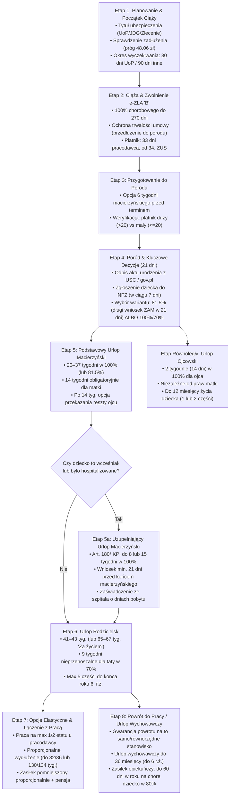

# ZUS DOMAIN RULES & BUSINESS LOGIC SPECIFICATION (STAN PRAWNY 2026)
**Projekt:** Zasiłkowy Przewodnik Przyszłego Rodzica (HackNation 2026)  
**Autor:** zus_domain_analyst  
**Status:** Wersja Kanoniczna (Single Source of Truth) dla Architektów, Analityków i Programistów

---

## 1. PODSTAWY PRAWNE I KONTEKST SYSTEMOWY (2026)

Dokument stanowi kompletny zbiór reguł biznesowych, ubezpieczeniowych, prawnych i formuł matematycznych wyekstrahowanych bezpośrednio z materiałów udostępnionych przez Zakład Ubezpieczeń Społecznych:
1. **Ustawa zasiłkowa**: Ustawa z dnia 25 czerwca 1999 r. o świadczeniach pieniężnych z ubezpieczenia społecznego w razie choroby i macierzyństwa (Dz.U. z 2026 r. poz. 854, z późn. zm.).
2. **Kodeks pracy**: Ustawa z dnia 26 czerwca 1974 r. – Kodeks pracy (Dz.U. z 2026 r. poz. 1245, z późn. zm.), w szczególności Dział VIII „Uprawnienia pracowników związane z rodzicielstwem”.
3. **Ustawa „Za życiem”**: Ustawa z dnia 4 listopada 2016 r. o wsparciu kobiet w ciąży i rodzin „Za życiem” (Dz.U. z 2024 r. poz. 1829 / art. 4 ust. 3).
4. **Rozporządzenie w sprawie dokumentów zasiłkowych**: Rozporządzenie MRPiPS z dnia 27 września 2026 r. (Dz.U. z 2026 r. poz. 1316).
5. **Rozporządzenie w sprawie wniosków rodzicielskich**: Rozporządzenie MRPiPS z dnia 11 marca 2025 r. (Dz.U. z 2025 r. poz. 322).
6. **Materiały ZUS 2026**: Poradnik dla rodziców i opiekunów dzieci (stan prawny kwiecień 2026 r.) oraz Załącznik parametryczny HackNation 2026.

---

## 2. PARAMETRY BAZOWE I PODSTAWA WYMIARU ZASIŁKÓW (2026)

### 2.1. Parametry Makroekonomiczne i Składkowe (2026)
* **Płaca minimalna (brutto)**: $4\,806{,}00\text{ zł}$
* **Stopa potrącenia składek pracowniczych**: $13{,}71\%$ (składka emerytalna $9{,}76\%$, rentowa $1{,}50\%$, chorobowa $2{,}45\%$)
* **Wskaźnik netto podstawy**: $100\% - 13{,}71\% = 86{,}29\% = 0{,}8629$
* **Minimalna podstawa wymiaru zasiłku dla pracownika**:
  $$\text{Podstawa}_{\min} = 4\,806{,}00\text{ zł} \times (1 - 0{,}1371) = 4\,147{,}10\text{ zł}$$
* **Maksymalna miesięczna podstawa dobrowolnego ubezpieczenia chorobowego (JDG)**: $250\%$ przeciętnego miesięcznego wynagrodzenia $= 23\,550{,}00\text{ zł}$
* **Maksymalna podstawa wymiaru zasiłku dla JDG (po odliczeniu 13,71%)**:
  $$\text{Podstawa}_{\max,\text{JDG}} = 23\,550{,}00\text{ zł} \times (1 - 0{,}1371) = 20\,321{,}30\text{ zł}$$
* **Próg zadłużenia blokujący wypłatę świadczeń (JDG / współpraca / ulga na start)**:
  $$\text{Próg}_{\text{dług}} = 1\% \times 4\,806{,}00\text{ zł} = 48{,}06\text{ zł}$$
* **Kwota zasiłku pogrzebowego (w tym w razie urodzenia martwego dziecka)**: $7\,000{,}00\text{ zł}$

---

### 2.2. Algorytm Wyznaczania Podstawy Wymiaru (Pracownicy)
Podstawę stanowi przeciętne miesięczne wynagrodzenie z okresu 12 miesięcy kalendarzowych poprzedzających miesiąc, w którym powstała niezdolność do pracy / prawo do zasiłku.

#### Reguły okresu referencyjnego:
1. **Zatrudnienie $\ge 12$ miesięcy**: Średnia z 12 pełnych miesięcy kalendarzowych.
2. **Zatrudnienie $< 12$ miesięcy**: Średnia z pełnych kalendarzowych miesięcy ubezpieczenia.
3. **Niezdolność w 1. miesiącu pracy**: Wynagrodzenie określone w umowie o pracę, po uzupełnieniu do pełnego miesiąca minus $13{,}71\%$.
4. **Niezdolność w 2. miesiącu pracy**: Wynagrodzenie za 1. pełny miesiąc (po uzupełnieniu, jeśli 1. miesiąc był niepełny) minus $13{,}71\%$.
5. **Reguła przerwy między zasiłkami**:
   * Przerwa $< 1$ miesiąca kalendarzowego: Podstawy **nie ustala się na nowo**; obowiązuje podstawa ustalona dla poprzedniego zasiłku.
   * Przerwa $\ge 1$ miesiąca kalendarzowego: Podstawę ustala się **na nowo** z 12 miesięcy poprzedzających nowy zasiłek.

#### Kwalifikacja i uzupełnianie składników wynagrodzenia:
* **Zasada przepracowania połowy miesiąca**:
  * Jeśli w danym miesiącu pracownik przepracował **mniej niż połowę** obowiązującego czasu pracy z przyczyn usprawiedliwionych (np. choroba) $\rightarrow$ miesiąc ten **wyłącza się całkowicie** z obliczeń.
  * Jeśli pracownik przepracował **co najmniej połowę** obowiązującego czasu pracy $\rightarrow$ wynagrodzenie za ten miesiąc podlega **uzupełnieniu**:
    * **Składniki stałe** (miesięczna stawka zasadnicza): przyjmuje się pełną kwotę z umowy minus $13{,}71\%$.
    * **Składniki zmienne** (np. premie pomniejszane za L4, prowizje):
      $$\text{Wynagrodzenie uzupełnione} = \frac{\text{Kwota faktycznie wypłacona}}{\text{Liczba dni przepracowanych}} \times \text{Liczba dni roboczych w miesiącu}$$
* **Składniki okresowe**:
  * Premie i nagrody **kwartalne**: wliczane w wysokości $1/12$ sumy wypłaconej za 4 kwartały poprzedzające.
  * Premie i nagrody **roczne** (np. trzynastka): wliczane w wysokości $1/12$ kwoty wypłaconej za rok poprzedzający.
* **Składniki wyłączone**: dodatki, które przysługują pracownikowi w okresie pobierania zasiłku bez pomniejszania (np. dodatek stażowy wypłacany obok zasiłku, nagrody uznaniowe niewiązane z absencją).

#### Stawka dzienna zasiłku:
Zgodnie z art. 11 ust. 5 i art. 31 ust. 5 ustawy zasiłkowej, 1 dzień zasiłku stanowi $1/30$ część miesięcznej podstawy (niezależnie od tego, czy miesiąc ma 28, 29, 30 czy 31 dni):
$$\text{Stawka dzienna brutto} = \frac{\text{Podstawa miesięczna}}{30} \times \text{Wskaźnik procentowy zasiłku}$$

---

## 3. WARUNKI UBEZPIECZENIA I OKRESY WYCZEKIWANIA (KARENCJA)

| Tytuł do ubezpieczenia | Typ ubezpieczenia chorobowego | Okres wyczekiwania (Chorobowe / L4) | Okres wyczekiwania (Zasiłek Macierzyński) | Okres wyczekiwania (Zasiłek Opiekuńczy) |
| :--- | :--- | :--- | :--- | :--- |
| **Umowa o pracę (UoP)** | Obowiązkowe | **30 dni** nieprzerwanego ubezpieczenia | **0 dni** (od 1. dnia ubezpieczenia) | **0 dni** (od 1. dnia ubezpieczenia) |
| **Umowa zlecenie** | Dobrowolne (na wniosek) | **90 dni** nieprzerwanego ubezpieczenia | **0 dni** (od 1. dnia ubezpieczenia) | **0 dni** (od 1. dnia ubezpieczenia) |
| **Działalność gospodarcza (JDG)** | Dobrowolne (na wniosek) | **90 dni** nieprzerwanego ubezpieczenia | **0 dni** (od 1. dnia ubezpieczenia) | **0 dni** (od 1. dnia ubezpieczenia) |

> [!IMPORTANT]
> **Kluczowa reguła:** Prawo do zasiłku macierzyńskiego przysługuje, jeśli matka podlega ubezpieczeniu chorobowemu **w dniu porodu**. Nie obowiązuje żaden okres wyczekiwania (ani 30, ani 90 dni). Jednakże prawo do zasiłku chorobowego w ciąży (przed porodem) wymaga spełnienia okresu wyczekiwania (30 dni dla UoP, 90 dni dla zlecenia/JDG).

### Zwolnienie z okresu wyczekiwania na zasiłek chorobowy:
Prawo do zasiłku chorobowego od 1. dnia ubezpieczenia przysługuje m.in.:
* absolwentom szkół lub uczelni, którzy zostali objęci ubezpieczeniem w ciągu 90 dni od ukończenia szkoły/dyplomu,
* ubezpieczonym, którzy mają wcześniejszy co najmniej 10-letni okres obowiązkowego ubezpieczenia chorobowego,
* posłom, senatorom, funkcjonariuszom przechodzącym do ubezpieczenia.

---

## 4. ZASIŁEK CHOROBOWY W OKRESIE CIĄŻY (KOD E-ZLA „B”)

1. **Wysokość świadczenia**: **$100\%$ podstawy wymiaru** (w odróżnieniu od standardowego L4 wynoszącego $80\%$).
2. **Maksymalny okres zasiłkowy**: **270 dni** (standardowe L4 trwa maksymalnie 182 dni).
3. **Podział płatnika (kto płaci w roku kalendarzowym)**:
   * **Pracownik $< 50$ lat**: pierwsze **33 dni** niezdolności w roku kalendarzowym finansuje **Pracodawca** (wynagrodzenie chorobowe, 100%), od **34. dnia** świadczenie przejmuje **ZUS** (zasiłek chorobowy, 100%).
   * **Pracownik $\ge 50$ lat**: pierwsze **14 dni** finansuje **Pracodawca**, od **15. dnia** finansuje **ZUS**.
   * **Niepracownicy (Zleceniobiorcy, JDG)**: od **1. dnia** niezdolności świadczenie wypłaca bezpośrednio **ZUS**.
4. **Wyjątek dotyczący zliczania okresu zasiłkowego w ciąży**:
   * Zgodnie z przepisami, poprzednie okresy choroby wlicza się do jednego okresu zasiłkowego, jeśli przerwa nie przekroczyła 60 dni.
   * **WYJĄTEK:** Jeśli nowa niezdolność wystąpiła w trakcie ciąży (kod „B”), **nie wlicza się okresów niezdolności sprzed przerwy**! Licznik okresu zasiłkowego (270 dni) bije na nowo.
5. **Szczególna ochrona i zasiłek po ustaniu zatrudnienia**:
   * Przedłużenie umowy do dnia porodu: Umowa na czas określony lub próbny $> 1$ miesiąca, która uległaby rozwiązaniu po upływie 3. miesiąca ciąży, ulega z mocy prawa przedłużeniu do dnia porodu (art. 177 § 3 KP).
   * Upadłość / likwidacja / śmierć pracodawcy w trakcie ciąży: Kobieta otrzymuje zasiłek chorobowy w wysokości $100\%$ do dnia porodu (zasiłek w wysokości zasiłku macierzyńskiego wypłacany przez ZUS).

---

## 5. ZASIŁEK MACIERZYŃSKI – URLOP MACIERZYŃSKI

Zasiłek przysługuje osobie podlegającej ubezpieczeniu chorobowemu w dniu porodu lub przyjęcia dziecka na wychowanie.

### 5.1. Wymiar Urlopu Macierzyńskiego (wg liczby urodzonych dzieci)

| Liczba dzieci przy jednym porodzie | Wymiar urlopu macierzyńskiego | Liczba dni |
| :--- | :--- | :--- |
| **1 dziecko** | **20 tygodni** | 140 dni |
| **2 dzieci (bliźniaki)** | **31 tygodni** | 217 dni |
| **3 dzieci (trojaczki)** | **33 tygodnie** | 231 dni |
| **4 dzieci (czworaczki)** | **35 tygodni** | 245 dni |
| **5 i więcej dzieci** | **37 tygodni** | 259 dni |

### 5.2. Reguły Podziału Urlopu Macierzyńskiego między Matkę a Ojca
1. **Opcja przed porodem**: Matka może rozpocząć urlop macierzyński na maksymalnie **6 tygodni przed przewidywaną datą porodu**. Po porodzie przysługuje pozostała część wymiaru (np. $20 - 6 = 14$ tygodni).
2. **Żelazne 14 tygodni matki**: Pierwsze **14 tygodni (98 dni)** po porodzie matka **musi wykorzystać osobiście**.
3. **Przejęcie przez ojca po 14 tygodniach**:
   * Po 14 tygodniach matka może zrezygnować z reszty urlopu i powrócić do pracy, pod warunkiem że ubezpieczony ojciec dziecka przejmie pozostałą część (np. 6 tygodni przy 1 dziecku, 17 tygodni przy bliźniakach).
   * Wniosek o rezygnację przez matkę i wniosek ojca muszą być złożone min. 7 dni przed planowanym powrotem.
4. **Wyjątki – przejęcie przez ojca PRZED upływem 14 tygodni**:
   Ojciec dziecka może przejąć urlop i zasiłek macierzyński wcześniej niż po 14 tygodniach wyłącznie, gdy:
   * Matka legitymuje się orzeczeniem o niezdolności do samodzielnej egzystencji,
   * Matka przebywa w szpitalu (zakładzie leczniczym) uniemożliwiającym opiekę nad dzieckiem (ojciec przejmuje zasiłek na czas hospitalizacji po wykorzystaniu przez matkę min. 8 tygodni),
   * Śmierć matki lub porzucenie dziecka przez matkę (ojciec przejmuje urlop od dnia następnego).

---

## 6. UZUPEŁNIAJĄCY URLOP MACIERZYŃSKI DLA WCZEŚNIAKÓW I DZIECI HOSPITALIZOWANYCH (NOWOŚĆ! ART. 180² KP)

Uzupełniający urlop macierzyński przysługuje pracownikom-rodzicom (matce albo ojcu) dzieci przedwcześnie urodzonych lub noworodków hospitalizowanych po porodzie.

### 6.1. Warunki i Zasady Przyznawania (Art. 180² KP)
* **Kto korzysta**: Matka albo ojciec wychowujący dziecko (tylko jedno z nich).
* **Kiedy przysługuje**: **Bezpośrednio po** zakończeniu podstawowego urlopu macierzyńskiego (przed urlopem rodzicielskim).
* **Forma**: Udzielany **jednorazowo**, bez możliwości podziału na części.
* **Wysokość zasiłku**: **$100\%$ podstawy wymiaru**.
* **Termin złożenia wniosku**: Nie krótszy niż **21 dni** przed zakończeniem korzystania z urlopu macierzyńskiego.
* **Wymagany dokument**: Zaświadczenie wydane przez szpital zawierające informację o tygodniu ciąży, masie urodzeniowej i okresie hospitalizacji.

### 6.2. Tabela Decyzyjna Wymiaru Uzupełniającego Urlopu Macierzyńskiego

| Kategoria przypadku | Warunek medyczny (Tydzień ciąży / Masa / Hospitalizacja) | Wymiar uzupełniającego urlopu macierzyńskiego | Maksymalny limit urlopu |
| :--- | :--- | :--- | :--- |
| **Kategoria 1: Skrajne wcześniaki** | Urodzenie **przed 28. tygodniem** ciąży **LUB** masa urodzeniowa $\le 1\,000\text{ g}$ | **1 tydzień** urlopu za każdy tydzień pobytu dziecka w szpitalu do upływu **15. tygodnia** po porodzie | **do 15 tygodni** |
| **Kategoria 2: Wcześniaki średnie** | Urodzenie **między 28. a 37. tygodniem** ciąży **ORAZ** masa urodzeniowa $> 1\,000\text{ g}$ | **1 tydzień** urlopu za każdy tydzień pobytu dziecka w szpitalu do upływu **8. tygodnia** po porodzie | **do 8 tygodni** |
| **Kategoria 3: Dzieci urodzone o czasie wymagające leczenia** | Urodzenie **po ukończeniu 37. tygodnia** ciąży **ORAZ** pobyt w szpitalu min. **2 kolejne dni** w okresie między **5. a 28. dniem** po porodzie | **1 tydzień** urlopu za każdy tydzień hospitalizacji dziecka w okresie **od 5. dnia do upływu 8. tygodnia** po porodzie | **do 8 tygodni** |
| **Kategoria 4: Ciąża mnoga (wieloraczki)** | Urodzenie co najmniej dwojga dzieci | Wymiar ustala się w oparciu o dziecko o **najniższej masie urodzeniowej** oraz dziecko **najdłużej hospitalizowane** | **do 8 lub 15 tygodni** |

### 6.3. Matematyczne Reguły Zaokrąglania Hospitalizacji (Art. 180² § 3 KP)
1. **Sumowanie pobytów**: Jeżeli dziecko miało kilka okresów hospitalizacji w dopuszczalnym przedziale (do 8. lub 15. tygodnia po porodzie), wszystkie te dni **sumuje się**.
2. **Przelicznik na tygodnie**:
   $$\text{Liczba pełnych tygodni} = \left\lceil \frac{\sum \text{Dni hospitalizacji}}{7} \right\rceil$$
3. **Zaokrąglanie w górę (Ceil)**: Zgodnie z art. 180² § 3 KP, **niepełny tydzień hospitalizacji zaokrągla się w górę do pełnego tygodnia urlopu**.
   * *Przykład:* Dziecko urodzone w 30. tygodniu ciąży przebywało w szpitalu łącznie 10 dni w pierwszych 8 tygodniach.  
     $10 / 7 = 1{,}43 \rightarrow$ po zaokrągleniu w górę rodzic ma prawo do **2 tygodni** uzupełniającego urlopu macierzyńskiego.

---

## 7. URLOP RODZICIELSKI – WYMIARY, STAWKI I WARIANTY FINANSOWE

Urlop rodzicielski przysługuje łącznie obojgu rodzicom po urlopie macierzyńskim.

### 7.1. Wymiar Urlopu Rodzicielskiego

| Przypadek urodzenia | Wymiar urlopu rodzicielskiego ogółem | Nieprzenoszalna część dla ojca | Nieprzenoszalna część dla matki | Maksymalny wymiar dla jednego rodzica |
| :--- | :--- | :--- | :--- | :--- |
| **1 dziecko (standard)** | **41 tygodni** | 9 tygodni | 9 tygodni | **32 tygodnie** |
| **2+ dzieci (standard)** | **43 tygodnie** | 9 tygodni | 9 tygodni | **34 tygodnie** |
| **1 dziecko („Za życiem”)** | **65 tygodni** | 9 tygodni | 9 tygodni | **56 tygodni** |
| **2+ dzieci („Za życiem”)** | **67 tygodni** | 9 tygodni | 9 tygodni | **58 tygodni** |

> [!IMPORTANT]
> **Kluczowa zasada unijna (Dyrektywa Work-Life Balance):** Każdemu z rodziców przysługuje **wyłączne, nieprzenoszalne prawo do 9 tygodni urlopu rodzicielskiego** ze wspólnej puli. Jeżeli jedno z rodziców (zazwyczaj ojciec) nie wykorzysta swoich 9 tygodni, część ta **bezpowrotnie przepada** i nie może być przekazana matce.

### 7.2. Warunki Korzystania z Urlopu Rodzicielskiego
* **Podział na części**: Urlop może być wykorzystany jednorazowo lub w maksymalnie **5 częściach**.
* **Horyzont czasowy**: Urlop można wykorzystać aż do zakończenia roku kalendarzowego, w którym dziecko kończy **6. rok życia**.
* **Jednoczesne korzystanie**: Oboje rodzice mogą korzystać z urlopu rodzicielskiego w tym samym czasie. W takim wypadku z puli odliczany jest podwójny czas (np. 4 tygodnie jednoczesnego urlopu mamy i taty zużywają 8 tygodni z łącznej puli).
* **Prawo ojca bez ubezpieczenia matki**: Ojciec ubezpieczony ma prawo do urlopu rodzicielskiego nawet wtedy, gdy matka dziecka w dniu porodu nie była ubezpieczona i nie miała prawa do zasiłku macierzyńskiego.

---

### 7.3. Warianty Finansowe Zasiłku Macierzyńskiego

#### Wariant 1: „Długi wniosek” – Uśredniona stawka 81,5%
* **Warunek konieczny**: Ubezpieczona matka musi złożyć pisemny wniosek (formularz ZAM) w terminie **nie później niż 21 dni po porodzie** o wypłatę zasiłku macierzyńskiego za okres urlopu macierzyńskiego oraz urlopu rodzicielskiego w pełnym przysługującym jej wymiarze (czyli do 32 tyg. przy 1 dziecku).
* **Wysokość świadczenia**:
  * Okres urlopu macierzyńskiego matki: **$81{,}5\%$ podstawy wymiaru**.
  * Okres urlopu rodzicielskiego matki (do 32 lub 34 tyg.): **$81{,}5\%$ podstawy wymiaru**.
  * **ŻELAZNY WYJĄTEK – 9 tygodni dla drugiego rodzica (ojca)**: Za okres 9 tygodni urlopu nieprzenoszalnego przysługuje zasiłek w wysokości **zawsze $70\%$ podstawy wymiaru** (ojciec nie otrzymuje stawki $81{,}5\%$).

#### Wariant 2: Standardowy – Dwa etapy (100% / 70%)
* **Stosowany gdy**: Matka nie złożyła wniosku w ciągu 21 dni po porodzie lub rodzice zdecydowali o wnioskowaniu odrębnym o poszczególne urlopy.
* **Wysokość świadczenia**:
  * Za okres urlopu macierzyńskiego (oraz uzupełniającego urlopu dla wcześniaków): **$100\%$ podstawy wymiaru**.
  * Za okres urlopu rodzicielskiego (dla matki i dla ojca, w tym za 9 tygodni ojca): **$70\%$ podstawy wymiaru**.

#### Reguła Wyrównania Zasiłku do 100% (Art. 31 ust. 4 ustawy zasiłkowej):
* Jeżeli ubezpieczona matka pobierała zasiłek w stawce uśrednionej **$81{,}5\%$**, ale:
  1. Nie pobrała ani jednego dnia zasiłku za okres urlopu rodzicielskiego w pierwszym roku życia dziecka, LUB
  2. Zrezygnowała z części urlopu rodzicielskiego,
* Przysługuje jej **jednorazowe wyrównanie wypłaconego zasiłku macierzyńskiego do $100\%$ podstawy wymiaru** za wykorzystany okres urlopu macierzyńskiego.
* Wyrównanie wynosi: $100\% - 81{,}5\% = 18{,}5\%$ podstawy wymiaru za każdy dzień pobranego macierzyńskiego.
* Wypłata wyrównania następuje na pisemny wniosek matki.

---

## 8. MATEMATYCZNY MODEL ŁĄCZENIA URLOPU RODZICIELSKIEGO Z PRACĄ (ART. 182¹ᶠ KP)

Pracownik może łączyć urlop rodzicielski z wykonywaniem pracy u dotychczasowego pracodawcy w wymiarze **nie wyższym niż 1/2 pełnego etatu** (np. 1/4, 1/3, 1/2 etatu).

### 8.1. Wzór na Wydłużenie Urlopu Rodzicielskiego (Art. 182¹ᶠ § 2 KP)
Okres urlopu ulega proporcjonalnemu wydłużeniu. Wymiar wydłużenia stanowi iloczyn liczby tygodni łączenia urlopu z pracą oraz wymiaru etatu:
$$\text{Wydłużenie (tygodnie)} = \text{Liczba tygodni łączonych} \times \text{Wymiar etatu}$$

*Jeżeli pracownik decyduje się łączyć pracę na 1/2 etatu przez cały przysługujący mu okres urlopu rodzicielskiego ($W$), wówczas urlop ulega podwojeniu:*
$$\text{Łączny czas urlopu łączonego} = \frac{W}{1 - \text{Wymiar etatu}} = \frac{W}{1 - 0{,}5} = 2 \times W$$

### 8.2. Ustawowe Limity Maksymalnego Czasu Trwania (Caps)

| Liczba dzieci / Status | Nominalny wymiar rodzicielskiego | Maksymalny wymiar po wydłużeniu pracą na 1/2 etatu (Art. 182¹ᶠ § 1 KP) |
| :--- | :--- | :--- |
| **1 dziecko** | 41 tygodni | **do 82 tygodni** ($41 \times 2$) |
| **2+ dzieci** | 43 tygodnie | **do 86 tygodni** ($43 \times 2$) |
| **1 dziecko („Za życiem”)** | 65 tygodni | **do 130 tygodni** ($65 \times 2$) |
| **2+ dzieci („Za życiem”)** | 67 tygodni | **do 134 tygodni** ($67 \times 2$) |

*Uwaga dot. zaokrąglania dni (Art. 182¹ᶠ § 4 KP):* Jeśli wydłużona część urlopu nie odpowiada pełnym tygodniom, urlop udzielany jest w dniach roboczych, a niepełny dzień pracy pomija się.

### 8.3. Wysokość Zasiłku i Całkowitego Dochodu w Czasie Łączenia (Art. 31 ust. 4a ustawy)
Zgodnie z art. 31 ust. 4a ustawy zasiłkowej, wysokość zasiłku macierzyńskiego **zmniejsza się proporcjonalnie do wymiaru czasu pracy**:
$$\text{Zasiłek wypłacany} = \text{Stawka bazowa zasiłku} \times (1 - \text{Wymiar etatu})$$

#### Analiza dochodu przy pracy na 1/2 etatu:
* **Wynagrodzenie z umowy o pracę**: $50\%$ dotychczasowej pensji brutto (płatne przez pracodawcę).
* **Zasiłek macierzyński**:
  * Przy wariancie 70%: $70\% \times (1 - 0{,}5) = \mathbf{35\%}$ podstawy wymiaru (płatne przez ZUS/płatnika).
  * Przy wariancie 81,5%: $81{,}5\% \times (1 - 0{,}5) = \mathbf{40{,}75\%}$ podstawy wymiaru.
* **Suma dochodu miesięcznego**:
  $$\text{Całkowity dochód} = 50\%\text{ pensji zasadniczej} + 35\%\text{ (lub } 40{,}75\%\text{) zasiłku}$$
* **Suma łączna w całym okresie**: Ponieważ pracownik pobiera $50\%$ kwoty zasiłku przez podwojony okres (np. przez 64 tygodnie zamiast 32), **łączna suma pobranego zasiłku w całym cyklu rodzicielskim jest w 100% zachowana**, a ponadto pracownik zarabia dodatkowo pół pensji co miesiąc.

---

## 9. URLOP OJCOWSKI (ART. 182³ KP)

1. **Podmiot uprawniony**: Pracownik-ojciec wychowujący dziecko (biologiczny lub adopcyjny). Jest to wyłączne i w pełni samodzielne prawo ojca (matka nie może go przejąć).
2. **Niezależność od matki**: Przysługuje ojcu także wtedy, gdy matka dziecka nie podlega ubezpieczeniu chorobowemu i nie pobiera zasiłku macierzyńskiego.
3. **Wymiar**: **2 tygodnie (14 dni kalendarzowych)**, wliczając soboty, niedziele i dni świąteczne.
4. **Liczba dzieci**: Urodzenie wieloraczków (bliźniąt, trojaczków) **nie wydłuża** urlopu ojcowskiego (zawsze 14 dni).
5. **Wysokość zasiłku**: **$100\%$ podstawy wymiaru**.
6. **Sposób podziału**:
   * Jednorazowo w całości: 14 dni, ALBO
   * W dwóch częściach: po **minimum 7 dni każda** (np. $7 + 7$ dni).
7. **Termin na wykorzystanie (Okres ważności)**:
   * **Dziecko biologiczne**: do ukończenia przez dziecko **12. miesiąca życia** (do 1. urodzin). Po tym dniu uprawnienie bezpowrotnie wygasa!
   * **Adopcja**: w ciągu 12 miesięcy od uprawomocnienia się postanowienia sądu orzekającego przysposobienie, nie później jednak niż do ukończenia przez dziecko **14. roku życia**.
8. **Termin złożenia wniosku**: Minimum **7 dni** przed rozpoczęciem korzystania z urlopu. Pracodawca ma bezwzględny obowiązek uwzględnić poprawnie złożony wniosek.

---

## 10. PRZYJĘCIE DZIECKA NA WYCHOWANIE (ADOPCJA I RODZINA ZASTĘPCZA)

### 10.1. Urlop na Warunkach Urlopu Macierzyńskiego
Przysługuje ubezpieczonemu, który przyjął dziecko na wychowanie jako **rodzina zastępcza niezawodowa** lub złożył wniosek do sądu o **przysposobienie (adopcję)**.

* **Wymiar urlopu**:
  * 1 dziecko: 20 tygodni
  * 2 dzieci jednocześnie: 31 tygodni
  * 3 dzieci jednocześnie: 33 tygodnie
  * 4 dzieci jednocześnie: 35 tygodni
  * 5 i więcej dzieci: 37 tygodni
* **Gwarantowany minimalny wymiar**: Urlop na warunkach macierzyńskiego **nie może być krótszy niż 9 tygodni**, nawet jeśli dziecko zbliża się do limitu wieku.
* **Granice wiekowe dziecka**:
  * **Rodzina zastępcza niezawodowa**: do ukończenia przez dziecko **7. roku życia** (lub do **10. roku życia**, jeżeli dziecko ma decyzję o odroczeniu obowiązku szkolnego).
  * **Przysposobienie (adopcja)**: do ukończenia przez dziecko **14. roku życia**.

### 10.2. Urlop Rodzicielski dla Rodziców Adopcyjnych i Zastępczych
* Wymiar i stawki są identyczne jak przy urodzeniu dziecka: **41 tygodni** (1 dziecko) lub **43 tygodnie** (2+ dzieci), w tym 9 tygodni nieprzenoszalne dla drugiego opiekuna.
* W przypadku dziecka z zaświadczeniem „Za życiem” wymiar wynosi **65 lub 67 tygodni**.

---

## 11. ZASIŁEK OPIEKUŃCZY (ART. 32–35 USTAWY)

Świadczenie z ubezpieczenia chorobowego przysługujące osobie zwolnionej od wykonywania pracy z powodu konieczności osobistego sprawowania opieki nad chorym lub zdrowym dzieckiem albo innym chorym członkiem rodziny.

### 11.1. Podstawowe Reguły i Warunki
1. **Wysokość zasiłku**: **$80\%$ podstawy wymiaru** (stawka dzienna: podstawa / $30 \times 80\%$).
2. **Okres wyczekiwania**: **BRAK** (zasiłek przysługuje od 1. dnia ubezpieczenia chorobowego).
3. **Warunek negatywny**: Zasiłek przysługuje pod warunkiem, że **we wspólnym gospodarstwie domowym nie ma innych członków rodziny mogących zapewnić opiekę**.
   * Za członka rodziny mogącego zapewnić opiekę uważa się np. bezrobotnego małżonka, domownika na urlopie, emeryta (chyba że stan zdrowia uniemożliwia opiekę).
   * **ŻELAZNY WYJĄTEK:** W przypadku opieki nad **chorym dzieckiem w wieku do lat 2**, zasiłek przysługuje **zawsze**, nawet gdy w domu przebywają inni domownicy!

### 11.2. Limity Dni w Roku Kalendarzowym (Wspólne dla Obojga Rodziców)

| Podstawa opieki / Kategoria podopiecznego | Wiek dziecka / członka rodziny | Limit dni w roku kalendarzowym |
| :--- | :--- | :--- |
| **Zdrowe dziecko** (nieprzewidziane zamknięcie żłobka/szkoły $<7$ dni, choroba niani, poród lub choroba drugiego rodzica stale opiekującego się) | **do lat 8** | **do 60 dni** |
| **Chore dziecko** | **do lat 14** | **do 60 dni** |
| **Chore dziecko z niepełnosprawnością** | **od 14 do 18 lat** | **do 30 dni** |
| **Zdrowe dziecko z niepełnosprawnością** (poród/choroba drugiego rodzica stale opiekującego się) | **do 18 lat** | **do 30 dni** |
| **Chore dziecko $> 14$ lat lub inny chory członek rodziny** (małżonek, rodzic, teść) | **powyżej 14 lat** | **do 14 dni** |
| **MAKSYMALNY ŁĄCZNY LIMIT ROCZNY** | Na wszystkie osoby łącznie | **60 dni w roku kalendarzowym** |

*Uwaga:* Limit 60 dni jest limitem **rodzinnym** (przypada łącznie na mamę i tatę w roku kalendarzowym, bez względu na liczbę dzieci w rodzinie). Dni opieki nie wliczają się do okresu zasiłkowego z tytułu własnej choroby.

---

## 12. OBIEG DOKUMENTÓW I REFORMA FORMULARZY (STAN OD 24 PAŹDZIERNIKA 2026 R.)

### 12.1. Wielka Konsolidacja Formularzy ZUS (24.10.2026 r.)
* **Nowy Zintegrowany Formularz ZAM**:
  Od 24 października 2026 r. formularz **ZAM** stanowi jednolity wniosek o zasiłek macierzyński, łączący dotychczasowe odrębne wnioski o macierzyński, rodzicielski i ojcowski.
* **Formularze zlikwidowane (nie wolno ich używać w systemie!)**:
  * ~~**ZUR**~~ (wniosek o zasiłek macierzyński za okres urlopu rodzicielskiego) – **zlikwidowany i scalony z ZAM**.
  * ~~**ZAO**~~ (wniosek o zasiłek macierzyński za okres urlopu ojcowskiego) – **zlikwidowany i scalony z ZAM**.
  * ~~**Z-3b**~~ (zaświadczenie płatnika dla prowadzących działalność gospodarczą) – **zlikwidowany**. ZUS pobiera dane bezpośrednio z konta płatnika w systemie Kompleksowego Systemu Informatycznego (KSI ZUS).

### 12.2. Aktualne Formularze w Obiegu (2026)
* **ZAM**: Wniosek ubezpieczonego o zasiłek macierzyński (za okres urlopu macierzyńskiego, uzupełniającego, rodzicielskiego lub ojcowskiego).
* **Z-3**: Zaświadczenie płatnika składek dla ubezpieczonych będących **pracownikami** (przekazuje pracodawca do ZUS).
* **Z-3a**: Zaświadczenie płatnika składek dla ubezpieczonych **niebędących pracownikami** (np. zleceniobiorcy).
* **ZAS-53**: Wniosek o zasiłek chorobowy / świadczenie rehabilitacyjne składany m.in. przez osoby prowadzące działalność.
* **ZAS-12**: Zaświadczenie płatnika na kolejny okres niezdolności do pracy.
* **Z-15A**: Wniosek o zasiłek opiekuńczy z powodu sprawowania opieki nad **dzieckiem**.
* **Z-15B**: Wniosek o zasiłek opiekuńczy z powodu sprawowania opieki nad **innym chorym członkiem rodziny**.
* **e-ZLA**: Elektroniczne zwolnienie lekarskie przekazywane automatycznie przez lekarza do ZUS i na profil PUE/eZUS płatnika.

### 12.3. Właściwość Płatnika Zasiłku (Zasada 20 Ubezpieczonych, Art. 61 Ustawy)
Liczbę ubezpieczonych ustala się według stanu na dzień **30 listopada poprzedniego roku kalendarzowego**:
1. **Płatnik $> 20$ ubezpieczonych (tzw. Duży Płatnik / Pracodawca)**:
   * Samodzielnie ustala prawo do zasiłków, oblicza ich wysokość i **wypłaca świadczenia bezpośrednio pracownikom** w terminach wypłaty wynagrodzeń.
   * Rozlicza wypłacone kwoty w ciężar należnych składek ZUS na deklaracji DRA.
2. **Płatnik $\le 20$ ubezpieczonych (tzw. Mały Płatnik)**:
   * Pracownik składa wniosek do pracodawcy, a pracodawca przekazuje wniosek wraz z zaświadczeniem **Z-3** (lub **Z-3a**) do ZUS.
   * **ZUS ustala prawo i wypłaca zasiłek bezpośrednio na konto ubezpieczonego** w ciągu 30 dni od daty wyjaśnienia ostatniej okoliczności.
3. **Przedsiębiorcy (JDG) i osoby współpracujące**:
   * Zasiłki **zawsze wypłaca bezpośrednio ZUS**.

### 12.4. Weryfikacja Zadłużenia Składek (Art. 2a Ustawy Zasiłkowej)
* **Kogo dotyczy**: Osób prowadzących pozarolniczą działalność, osób współpracujących oraz korzystających z Ulgi na Start.
* **Stan zadłużenia**: Weryfikowany na **dzień powstania prawa do świadczenia**.
* **Próg zadłużenia**: Kwota przekraczająca **$1\%$ minimalnego wynagrodzenia** ($48{,}06\text{ zł}$ w 2026 r.).
* **Konsekwencje**:
  * Jeżeli dług $> 48{,}06\text{ zł}$ $\rightarrow$ prawo do zasiłku jest **zawieszone**.
  * **Spłata w ciągu 6 miesięcy**: Jeżeli zadłużenie zostanie spłacone w całości w terminie 6 miesięcy od dnia powstania prawa, ZUS wypłaca należny zasiłek za cały okres wstecz.
  * **Przedawnienie po 6 miesiącach**: Jeżeli zadłużenie nie zostanie spłacone w ciągu 6 miesięcy $\rightarrow$ **prawo do zasiłku za dany okres bezpowrotnie przedawnia się**!

---

## 13. PRZYPADKI SZCZEGÓLNE I TRUDNE ORAZ INSTYTUCJE WSPARCIA

### 13.1. Urodzenie Martwego Dziecka / Poronienie
1. **Wymiar urlopu i zasiłku macierzyńskiego**:
   * Przysługuje urlop macierzyński w skróconym wymiarze **8 tygodni (56 dni)** po porodzie, nie krócej jednak niż przez okres **7 dni od dnia zgonu dziecka** (art. 180¹ § 1 KP).
   * W przypadku ciąży mnogiej, gdy jedno z dzieci zmarło, matce przysługuje urlop w wymiarze odpowiednim do liczby dzieci pozostałych przy życiu.
2. **Wysokość zasiłku**: **$100\%$ podstawy wymiaru**.
3. **Wymagane dokumenty**:
   * Odpis skrócony aktu urodzenia dziecka z adnotacją, że dziecko urodziło się martwe (USC wystawia na podstawie karty martwego urodzenia przekazanej przez szpital).
   * Jeśli akt urodzenia nie został sporządzony (np. z powodu trudności z ustaleniem płci w bardzo wczesnym poronieniu): zaświadczenie lekarza specjalisty ginekologa/położnika potwierdzające martwe urodzenie wydane na podstawie dokumentacji medycznej.
4. **Zasiłek pogrzebowy**:
   * Przysługuje osobie, która zorganizowała i sfinansowała pochówek dziecka (niezależnie od czasu trwania ciąży).
   * Kwota w 2026 r.: **$7\,000{,}00\text{ zł}$**.
   * Termin złożenia wniosku do ZUS: do 12 miesięcy od dnia pogrzebu.

### 13.2. Zgon Dziecka po Upływie 8 Tygodni Życia
* Matka zachowuje prawo do zasiłku macierzyńskiego przez okres **7 dni od dnia zgonu dziecka** (art. 180¹ § 2 KP).

### 13.3. Dzieci z Zaświadczeniem „Za życiem”
* Wydawane na podstawie art. 4 ust. 3 ustawy o wsparciu kobiet w ciąży i rodzin „Za życiem” przez lekarza ubezpieczenia zdrowotnego (specjalistę ginekologii, perinatologii, neonatologii, neurologii/kardiologii dziecięcej).
* Stwierdza ciężkie i nieodwracalne upośledzenie albo nieuleczalną chorobę zagrażającą życiu, powstałą w okresie prenatalnym lub w czasie porodu.
* Uprawnia do wydłużenia urlopu rodzicielskiego: do **65 tygodni** (1 dziecko) lub **67 tygodni** (2+ dzieci).

### 13.4. Wykaz Pozarządowych Instytucji Wsparcia i Pomocy Psychologicznej
W aplikacji przewodnik powinien w empatyczny i nienachalny sposób prezentować kontakt do podmiotów pomocowych:
1. **Fundacja Rodzić po Ludzku** – monitoring opieki okołoporodowej, wsparcie prawne dla kobiet w ciąży i matek.
2. **Koalicja dla Wcześniaka / Fundacja Wcześniak** – wsparcie rodziców wcześniaków, pomoc w rehabilitacji, doradztwo medyczne i wypożyczalnie sprzętu.
3. **Fundacja Pomocy Rodzinom Po Stracie Dziecka / Fundacja Niezapominajka** – grupy wsparcia psychologicznego po poronieniu i śmierci noworodka.
4. **Fundacja Ernesta** – bezpłatne konsultacje prawne i psychologiczne po stratach okołoporodowych.
5. **Fundacja Gajusz (Hospicjum Perinatalne)** – kompleksowe wsparcie medyczne i psychologiczne dla rodziców oczekujących na narodziny ciężko chorego dziecka.
6. **Telefon Zaufania dla Rodziców po Stracie**: bezpłatna infolinia wsparcia kryzysowego.

---

## 14. MAPA ETAPÓW PODRÓŻY RODZICA (JOURNEY MAP)



---

## 15. SPECYFIKACJA DLA ARCHITEKTÓW I SILNIKA KALKULATORA (TYPESCRIPT SPEC)

Poniższy pseudokod i typy definiują kontrakt danych silnika obliczeniowego kalkulatora:

```typescript
export interface MaternityCalculatorInput {
  parentType: 'mother' | 'father';
  contractType: 'employment' | 'mandate' | 'b2b'; // UoP | Zlecenie | JDG
  monthlyBaseGross: number; // Przychód brutto / podstawa składek
  childrenCount: number; // 1, 2, 3, 4, 5+
  hasLifeCertificate: boolean; // Zaświadczenie "Za życiem"
  submissionWithin21Days: boolean; // Czy wniosek ZAM złożony w ciągu 21 dni
  
  // Wcześniactwo i hospitalizacja
  isPrematureOrHospitalized: boolean;
  birthWeek?: number; // Tydzień ciąży
  birthWeightGrams?: number; // Waga w gramach
  hospitalDaysTotal?: number; // Suma dni hospitalizacji w oknie referencyjnym
  hospitalizationFromDay5To28ConsecutiveMin2?: boolean; // Warunek dla dzieci po 37 tyg.
  
  // Łączenie z pracą na rodzicielskim
  workPartTimeDuringParental: boolean;
  workFteRatio?: number; // np. 0.5 (1/2 etatu), 0.25 (1/4 etatu)
  workWeeks?: number; // Liczba tygodni łączenia
}

export interface MaternityCalculatorOutput {
  maternityLeaveWeeks: number; // Wymiar macierzyńskiego
  supplementaryWeeks: number; // Wymiar uzupełniającego (wcześniaki)
  parentalLeaveTotalWeeks: number; // Łączny wymiar rodzicielskiego
  parentalLeaveMomMaxWeeks: number; // Pula dla mamy (np. 32 lub 56 tyg.)
  parentalLeaveDadReservedWeeks: number; // 9 tygodni nieprzenoszalne dla taty
  
  // Stawki procentowe
  momMaternityRate: number; // 100% lub 81.5%
  momParentalRate: number; // 70% lub 81.5%
  dadReservedParentalRate: number; // Zawsze 70%
  supplementaryLeaveRate: number; // Zawsze 100%
  
  // Wydłużenie urlopu rodzicielskiego przy pracy na część etatu
  parentalExtensionWeeks: number;
  totalExtendedParentalWeeks: number;
  
  // Wartości finansowe (brutto)
  dailyBaseAmount: number; // Podstawa dzienna po odliczeniu 13.71%
  maternityMonthlyBenefit: number;
  parentalMonthlyBenefitMom: number;
  parentalMonthlyBenefitDad: number;
  totalBenefitAmountSum: number;
}
```

### Podsumowanie Formuł Matematycznych dla Silnika:
1. $\text{Podstawa Netto} = \text{Podstawa Brutto} \times 0{,}8629$
2. $\text{Stawka Dzienna} = \frac{\text{Podstawa Netto}}{30}$
3. $\text{Zasiłek Dzienny} = \text{Stawka Dzienna} \times \text{Stawka Procentowa}$
4. $\text{Wymiar Uzupełniającego} = \min\left(\left\lceil \frac{\text{Dni Hospitalizacji}}{7} \right\rceil, \text{Limit}\right)$ gdzie Limit wynosi 8 lub 15 tyg.
5. $\text{Wydłużenie Rodzicielskiego} = \text{Tygodnie Pracy} \times \text{Wymiar Etatu}$
6. $\text{Zasiłek przy Pracy} = \text{Zasiłek Nominalny} \times (1 - \text{Wymiar Etatu})$
7. $\text{Wyrównanie do 100\%} = (\text{Stawka Dzienna} \times 1{,}00 - \text{Stawka Dzienna} \times 0{,}815) \times \text{Dni Macierzyńskiego} = \text{Stawka Dzienna} \times 0{,}185 \times \text{Dni Macierzyńskiego}$
